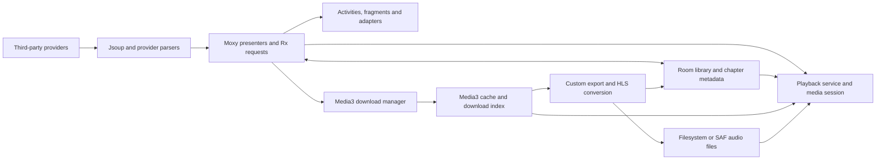
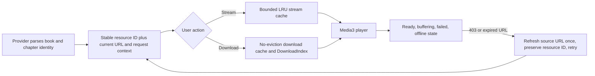

# Android Audiobooks — critical technical and product audit

**Audit date:** October 22, 2026. **Project:** `com.fanok.audiobooks`, version `7.3` / code `95`. **Location:** `C:\work\audiobook`. **Scope:** the supplied source/resources, build configuration, Room schema, locally built APKs, lint reports, bounded provider probes, emulator recovery, Android UI/service checks and isolated instrumentation of production methods.

## Assessment

**This application should not be considered ready for a dependable production release in its current state.** It builds, but several core flows can delete unrelated files, destroy library data, corrupt exported audio, show incomplete downloads as finished, return the wrong search results, or leave playback controls unable to recover. The networking layer deliberately disables server authentication, and reusable service credentials are distributed in source. Those are concrete implementation findings, not merely style preferences.

The most urgent work is to protect user data and credentials, then restore consistent download/search/playback state. Cosmetic redesign should follow those repairs. Some apparent defects were rejected after checking lifecycle rules, source callers, library versions and merged manifests; that cross-checking is documented below.

### Highest-priority findings

| Priority | Finding and practical impact | Detailed entries |
|---|---|---|
| Immediate | Book deletion recursively erases a track's parent directory and other name-matching folders, including unrelated files. | D01, D09, D14 |
| Immediate | Restore accepts `{}` as a successful empty backup and clears favorites, history, positions and chapter lists. | UI-01 |
| Immediate | TLS certificate/hostname verification is bypassed, including login requests; client contains reusable bot/proxy credentials. | S01, C13 |
| Before release | Exports combine cache bytes from sibling chapters; write failures can still commit local-file success. | D02, D05, D06 |
| Before release | A version-15→17 migration drops a required index; other migration policies permit data loss. | D03, D04 |
| Before release | Download controls mix book IDs with chapter IDs; a single chapter can mark a book 100% complete. | D07, D08 |
| Before release | Folder changes can leave Media3 using a released manager; download recovery scheduler is absent from merged manifests. | Q01, N02 |
| Before release | Offline fallback can choose another book's identically named chapter; online refresh overwrites local mappings. | D11, D12, D13 |
| Before release | Pagination changes query text/IDs; search A can overwrite search B; sources repeatedly return their first page. | S02–S08 |
| Before release | Service teardown submits work after shutting down its executor; app crash handler suppresses normal delegation. | C01, C02 |
| Before release | Pause may resume playback, buffering cannot reliably be paused, and terminal errors have no usable retry. | C03, C04, C11 |
| Before release | Returning to Favorites or rotating Downloads leaves retained presenters with destroyed dependencies. | UI-02, Q02 |
| Before release | Theme code overwrites TV configuration bits; parental controls use incompatible category keys. | UI-03, UI-04 |
| Before release | Release signing uses a debug key; target API and native-library compatibility require release work. | C15, C16, N01 |
| Subsequent hardening | Leaked/retained tasks, unbounded responses, duplicate timer chains, inaccessible controls and incomplete UI states. | C08–C10, Q03, S09/S12, UI-07–UI-15, LINT-UI entries |

### How to read this document

- **Critical:** immediate data-loss or credential/network trust exposure; address before users exercise the affected path.
- **High / P1:** important broken behavior, crash, serious corruption or release/integration blocker under the stated trigger.
- **Medium / P2:** functional, resource, accessibility, resilience or maintainability defect with narrower impact.
- **Low / P3:** improvement or a conditional design concern requiring rendered validation.
- **Confirmed source defect** means its mechanism is demonstrated by the implementation. It does **not** mean an Android device reproduced it. Executed build checks, local algorithm probes, artifact inspection and live network observations are identified separately.
- **Conditional risk** states the required input, device, provider or timing condition; it is not presented as an observed incident.
- Paths such as `service/...`, `room/...`, `presenter/...`, `adapter/...`, `model/...`, `activity/...`, `fragment/...`, `pojo/...`, `util/...`, `android_equalizer/...`, or `J/...` resolve under **`app/src/main/java/com/fanok/audiobooks/`**. `res/...` resolves under **`app/src/main/res/`**. Bare filenames in a finding refer to the same named file already introduced there. Line references describe this audit snapshot, not a moving upstream branch.

Related entries sometimes describe different manifestations of the same underlying ownership/identity problem. Their count should not be interpreted as a count of independent production incidents. There is no claim that this audit proves the absence of further defects.

### Contents

1. [Executed verification and limits](#executed-verification-and-limits)
2. [Architecture and independent-review method](#architecture-and-independent-review-method)
3. [Playback, security, build and architecture audit](#playback-security-build-and-architecture-audit)
4. [Search, catalog, provider, and networking audit](#search-catalog-provider-and-networking-audit)
5. [Download, storage, offline and persistence audit](#download-storage-offline-and-persistence-audit)
6. [UI, navigation, lifecycle, accessibility and settings audit](#ui-navigation-lifecycle-accessibility-and-settings-audit)
7. [Additional findings from GPT-6.1](#additional-findings-from-gpt-61)
8. [Built APK native compatibility and merged-manifest verification](#built-apk-native-compatibility-and-merged-manifest-verification)
9. [Focused stream, cache and fast-search audit](#focused-stream-cache-and-fast-search-audit)
10. [Android lint results and manual triage](#android-lint-results-and-manual-triage)
11. [Live provider reachability](#live-provider-reachability)
12. [Application runtime checks](#application-runtime-checks-on-the-recovered-emulator)
13. [Android instrumentation evidence](#android-instrumentation-evidence)
14. [Emulator recovery investigation](#emulator-recovery-investigation)
15. [Prioritized remediation and regression plan](#prioritized-remediation-and-regression-plan)

## Executed verification and limits

### What was actually run

| Check | Actual result | Interpretation |
|---|---|---|
| Source inventory/review | 161 Java files, approximately 36,994 Java lines, 261 resource files; no project AGENTS.md found | Broad source audit with focused call-chain checks; not a claim every possible execution path was covered |
| Initial Gradle bootstrap | Failed because Java was not on PATH and JAVA_HOME was unset | Environment issue, subsequently resolved |
| Tool installation | Temurin JDK 17.0.20.1+1; Android command-line tools, SDK platform 36, Build-Tools 35.0.0, platform-tools, emulator and API-34 x86_64 image | Downloads from official distribution endpoints; JDK, command-line-tools and archived emulator checksums verified |
| Gradle wrapper | Gradle 8.13 successfully ran | Wrapper/toolchain usable |
| Initial debug assembly | Compilation succeeded; signing failed because `.android/debug.keystore` did not exist | Build depends on a machine-local debug key even through its named release configuration |
| Debug assembly after local debug-key generation | **Passed**, `app-debug.apk`, 23,889,229 bytes | No application-source repair or check suppression required |
| Minified release assembly | **Passed**, `app-release.apk`, 12,451,669 bytes | R8/release packaging completed; this is still debug-key-signed configuration, not a production signing endorsement |
| `testDebugUnitTest` | **NO-SOURCE** | No unit tests executed; not a successful behavioral test suite |
| `lintDebug` | **Failed: 84 errors, 386 warnings, 1 hint** | 79 errors concern Media3 unstable API opt-in; diagnostics were manually triaged and deduplicated |
| Combined Gradle invocation | Exit code 1 because `lintDebug` failed; `--continue` allowed both APK tasks to finish | Do not label the overall quality gate green just because APKs exist |
| APK native ZIP alignment | Official `zipalign -v -c -P 16 4` passed for debug and release | Correct APK entry alignment |
| APK native ELF inspection | Conscrypt shared libraries use 4 KB LOAD alignment; relevant 64-bit segments fail 16 KB congruence | Confirmed packaged-native compatibility defect, distinct from ZIP alignment |
| Local SQL/string/predicate checks | Reproduced lost migration index, sibling cache-key selection, query/ID corruption, deletion-name collision and lexical chapter order | Executed isolated algorithm checks, not Android instrumentation or destructive media operations |
| Nine unauthenticated homepage probes | Four HTTP 200, four TLS certificate-expiry validation failures, one HTTP 403 challenge | One bounded GET per source, no credentials or media; results are specific to this machine/network/time |
| Emulator recovery | Installed signed AEHD 2.2 through authorized Windows UAC; acceleration check passed and Emulator 37.2.12 booted Android 14/API 34 | Initial software-emulation crashes were host/tooling failures; hardware-accelerated configuration works without reboot |
| Debug app UI smoke checks | Installed app; captured onboarding, loaded Akniga catalog and multi-provider `1984` search results | Real Android UI operation, not comprehensive source compatibility or accessibility validation |
| Minified release smoke check | Installed release update, cold-launched MainActivity, captured populated Akniga catalog with no new AndroidRuntime fatal exception in the checked log | Release startup/catalog works on this AVD; it remains signed with the local debug key |
| Real playback service | Generated local WAV reached PLAYING; two pause commands changed PLAYING → PAUSED → PLAYING | Non-idempotent pause reproduced; host audio was disabled on primary test AVD |
| Playback teardown | Actual active-service stop threw RejectedExecutionException at stopMedia:1387/onDestroy:544; same app PID persisted after fatal main-thread error | C01/C02 corroborated by actual runtime and preserved crash report |
| Isolated production-method instrumentation | Six checks completed with zero harness failures: actual exporter, migrations, Room rejection/rollback, restore, invalid buffer values and timer resume | Targeted defects reproduced; PASS means the defective outcome was successfully asserted |
| Bound-service HTTP fault injection | Actual service exhausted four 503 requests; normal Play did not retry after recovery, but explicit prepare succeeded. Pause during buffering still allowed later playback | C04 and the buffering half of C03 reproduced with real player states/request counts and positive control |
| Audio-enabled emulator startup | A second isolated headless AVD booted with audio enabled and reported speaker output; then shut down | No immediate audio-backend crash; audible quality/headset behavior not tested |

The final combined command was:

```powershell
. 'C:/Users/user/AppData/Local/audiobook-audit-tools/environment.ps1'
./gradlew.bat :app:assembleDebug :app:testDebugUnitTest :app:lintDebug :app:assembleRelease --continue --no-daemon --console=plain
```

Installed tools and reusable environment/emulator-launch scripts remain in `C:\Users\user\AppData\Local\audiobook-audit-tools`; machine-wide PATH changes were not required. The signed AEHD 2.2 Windows driver was additionally installed and is running. A standard local debug keystore was generated at `C:\Users\user\.android\debug.keystore`. Application Java/XML/build configuration was not intentionally edited. The separate instrumentation APK/source live in the tools directory. Generated Gradle outputs/caches and the report are expected additions. The original repository files were already untracked at audit start, so this was a whole-tree review, not a review against a reliable committed baseline.

Evidence retained locally:

- [Debug lint HTML](app/build/reports/lint-results-debug.html), [XML](app/build/reports/lint-results-debug.xml), [text](app/build/reports/lint-results-debug.txt).
- [Build log](C:/Users/user/AppData/Local/audiobook-audit-tools/gradle-full-audit.log) and [initial signing failure](C:/Users/user/AppData/Local/audiobook-audit-tools/gradle-debug-audit.log).
- [Provider probe JSON](C:/Users/user/AppData/Local/audiobook-audit-tools/provider-probe.json).
- [Emulator 37 log](C:/Users/user/AppData/Local/audiobook-audit-tools/emulator-run.log) and [emulator 35 log](C:/Users/user/AppData/Local/audiobook-audit-tools/emulator-35-run.log).
- [Working emulator launcher](C:/Users/user/AppData/Local/audiobook-audit-tools/start-audit-emulator.ps1), [instrumentation output](C:/Users/user/AppData/Local/audiobook-audit-tools/runtime-harness/instrumentation-final-run.txt) and [real service crash](C:/Users/user/AppData/Local/audiobook-audit-tools/runtime-stopservice-crash.txt).
- Built [debug APK](app/build/outputs/apk/debug/app-debug.apk) and [release APK](app/build/outputs/apk/release/app-release.apk); hashes and native checks appear in N01.

### What remains unverified

The audit includes Android UI screenshots/interactions, generated-audio playback, a real service-stop crash, and isolated execution of actual export/migration/restore/timer/player-initialization methods. It does **not** include a TalkBack session, heap dump, long-duration battery/playback test, Android Auto host, 16 KB device, full OEM/SAF matrix or complete provider-download/HLS-quality certification. Visual observations distinguish the captured default phone UI from unrendered variants. Resource leaks are described by ownership paths, without invented heap-size or battery measurements. Strict-TLS homepage probes and a successful app search are separate evidence; neither establishes every authenticated/streaming flow. No exposed credential was tested and no destructive helper/restore ran on real user data.

The initial emulator blocker was resolved by the dedicated investigation documented later. The working Android 14 emulator remains available for follow-up. Other OS/device variants remain untested. Optional cleanup of duplicate SDK package directories was rejected by automatic approval review with only “blocked by policy”; those tool folders were left in place. They did not prevent builds, emulator boot or testing.

## Architecture and independent-review method

The app is a Java/XML Android application using Moxy presenters, RxJava 2, Jsoup scraping, Room, Media3/ExoPlayer, a legacy MediaSessionCompat browser service, Picasso/Glide, and both filesystem and Storage Access Framework paths. Nine third-party providers feed catalog, search and media extraction. Media3 downloads are additionally exported into user-visible files and persisted in a separate Room model.



The highest-risk boundaries are where a display name/URL substitutes for a stable identity, where cache contents become exported files, where multiple stores disagree on completion, and where a retained presenter or service loses ownership of its asynchronous work.

Three parallel area reviews covered search/networking, download/storage/persistence, and UI/lifecycle. At the user's request, separate **GPT-6** and **GPT-6.1** reviewers independently challenged the findings and checked source/library behavior. Model agreement was used to guide verification, not as proof by itself.

| Topic | GPT-6 check | GPT-6.1 check | Final treatment |
|---|---|---|---|
| Destructive file cleanup | Confirmed parent-folder deletion through ordinary import paths | Confirmed no per-file ownership guard | Critical D01 retained |
| Cache export mixes chapters | Confirmed common-directory key predicate | Independently reproduced sibling-key selection | High D02 retained |
| Room migration | Confirmed index-name collision; flagged rollback nuance | Independently reproduced missing index and distinguished fallback policy | D03 retained; D04 explicitly conditional on final validation/commit |
| Invalid backup restore | Confirmed `{}` clears four stores and returns success | Confirmed mutation-before-validation | UI-01 retained |
| Service teardown / pause | Confirmed rejected executor submission and non-idempotent pause | Confirmed source chain and buffering state distinction | C01/C03 retained, related manifestations grouped |
| Cold media-browser binding | Warned callback ordering can defer subscriptions | Agreed not to claim a normal null-pointer crash | C06 reports missing cold initialization, not a reproduced crash |
| Download storage change | Existing review covered storage/export lifetime | Found Media3's cached service helper still using released manager | New Q01 |
| Downloads rotation | Existing review covered Favorites' view lifetime | Verified exact Moxy dependency retains manually destroyed presenter | New Q02 |
| Thread ownership | Existing review covered callback/task retention | Found caller-owned fixed pool never shut down | New Q03 |

Further rejected claims: a loader Back loop (manifest has `noHistory`); permanently stale BookActivity static ownership (cleared on destruction); a shallow-object DiffUtil bug (rows are cloned); missing boot/wake/network permissions (present in merged manifest); and blanket claims that every old receiver overload, resource variant or ignored lint item crashes. The report keeps the underlying issues that survived those checks.

---

## Playback, security, build and architecture audit

In the locations below, `J/` means `app/src/main/java/com/fanok/audiobooks/`. A confirmed source defect means the implementation and its trigger were traced; it does not imply the Android application was run to reproduce it. Runtime results are recorded separately in the final report.

### C01 — High: destroying the playback service can throw before releasing its resources

**Confidence: confirmed control-flow defect.** `J/service/MediaPlayerService.java:538-549` shuts down `dbExecutor` before calling `stopMedia()`. When a player still exists, `stopMedia()` submits another task to that executor at `1380-1396`. `ExecutorService.shutdown()` rejects new work. The `try/catch` is inside the submitted task, so it cannot catch rejection at submission. A `RejectedExecutionException` interrupts destruction before player release, audio-focus removal, effect cleanup and receiver unregistration.

**Trigger/impact:** stop the service while its player remains allocated, for example through the media-session stop action (`1172-1178`). Closing an already released player does not exercise this branch. The failure can lose the final position and leave teardown incomplete; the app's custom uncaught-exception handler compounds the effect (C02).

**Fix:** stop new callbacks first, capture and persist the final immutable playback snapshot while the executor still accepts work, release player/session/effects and receivers in reliable cleanup paths, then shut down the executor. Do not block the main thread waiting for a long write queue.

**Regression check:** stop while playing, paused, buffering and immediately after a chapter change; assert no uncaught exception, final progress persisted, and no service/session/receiver left alive.

**Runtime corroboration:** stopping the real service during generated-WAV playback on Android 14 produced the exact rejection at `stopMedia:1387` / `onDestroy:544`. See the runtime section and preserved crash log.

### C02 — High: the application replaces Android's crash handler without delegating

**Confidence: confirmed implementation defect; exact visible aftermath depends on the crashing thread/device.** `J/App.java:270-275` installs a default uncaught-exception handler that writes a file and returns. It neither retains/calls the previous handler nor terminates the process. It therefore bypasses the normal handler's crash reporting and process termination. A main-thread exception can leave a live process with a dead UI thread rather than a clean crash/restart. This does not mean Android can never log the exception: platform pre-handlers may still log it.

**Fix:** retain the previous handler and delegate in `finally`, with a defensible fallback if none exists. Keep logging bounded and independent of fragile application initialization. Do not swallow fatal exceptions merely to create a crash file.

**Regression check:** inject a main-thread and worker-thread exception in a test build; confirm the local report and normal system crash behavior both occur.

### C03 — High: pause is not an idempotent command and buffering cannot reliably be paused

**Confidence: confirmed state-machine defects.** `J/service/MediaPlayerService.java:1144-1150` implements session `onPause()` as a toggle: when the player is already paused it calls `resumeMedia()`. `pauseMedia()` (`1225-1229`) only clears `playWhenReady` when `isPlaying()` reports READY and playing (`578-584`). During BUFFERING, a pause/noisy-audio/focus-loss request does not clear the intention to play. The app's play receiver (`449-460`) also handles buffering as a not-yet-loaded warning instead of honoring a requested pause.

**Trigger/impact:** two pause commands can restart audio; unplugging headphones or receiving an interruption while a stream buffers can allow playback to start afterward. `AUDIOFOCUS_LOSS` sets a separate boolean but still relies on this ineffective pause (`607-617`). This affects safety and user trust in pause controls.

**Fix:** implement `play`, `pause`, and toggle as distinct commands. Pause should clear `playWhenReady` for every non-released player state. Derive UI state from the player plus an explicit user intent, rather than treating READY as the only state that can be controlled.

**Regression check:** duplicate pause, pause during prepare/rebuffer/seek, headphone removal during buffering, transient/permanent focus loss, and a call interrupted by network recovery.

**Runtime corroboration:** real service commands changed the fixture's session from PLAYING to PAUSED on the first pause and back to PLAYING on the second. A separate bound-service HTTP fixture held its response while buffering; the real pause command left `playWhenReady=true`, and releasing the response started playback without another Play. Focus/headset cases still require their own checks.

### C04 — High: terminal playback failures leave a player that the UI cannot retry

**Confidence: confirmed recovery gap.** `J/service/MediaPlayerService.java:1060-1066` only logs/toasts `onPlayerError`. The ordinary play receiver (`449-460`) calls `resumeMedia()` only for READY, initializes only when the player is null, and otherwise displays a loading warning. `resumeMedia()` also requires READY (`1462-1465`). A failed ExoPlayer remains allocated but transitions to IDLE, so neither path calls `prepare()` again or obtains a fresh expiring URL. [Media3's player-event documentation](https://developer.android.com/media/media3/exoplayer/listening-to-player-events) documents the IDLE transition and retry by preparing again.

**Trigger/impact:** a terminal network, decoding, authorization or unavailable-file error can leave a permanent apparent loading state. A transient toast exposes an internal error code without a persistent recovery action. The static `isPlay` value and notification can also retain their pre-error state because IDLE is not reconciled.

**Fix:** expose an explicit error state with retry, refresh URLs when appropriate, and restore position after re-preparing. Reconcile session state, notification, timers and foreground status on errors and IDLE.

**Regression check:** terminate a stream, restore connectivity, expire a signed URL and remove a local file; retry should recover when possible and explain non-recoverable cases.

**Runtime corroboration:** an actual bound service reached terminal IDLE after four HTTP 503 requests. After the controlled endpoint became healthy, app Play and media-session Play each left the same player idle and the request count at four. Explicitly calling `prepare()` on that same player caused request five and successful READY/playing recovery. This directly confirms the missing retry transition; signed-URL refresh remains a separate untested case.

### C05 — High: a valid buffer preference can crash player construction

**Confidence: confirmed against the exact declared Media3 version's source.** `J/fragment/SettingsFragment.java:331-334` accepts `1` and the strings `00`/`000`. `J/service/MediaPlayerService.java:964-967` parses the value as seconds and sets both minimum and maximum buffer duration to it, while retaining Media3's default after-rebuffer threshold. In [Media3 1.9.0 DefaultLoadControl](https://github.com/androidx/media/blob/1.9.0/libraries/exoplayer/src/main/java/androidx/media3/exoplayer/DefaultLoadControl.java), that threshold is 2,000 ms and the builder rejects a smaller minimum. Thus one second or a multi-digit zero passes the settings UI and throws during playback initialization.

**Fix:** validate the parsed numeric value against the actual load-control constraints, enforce a sensible upper bound, and validate again where persisted settings are consumed. Migrate invalid existing values to a safe default.

**Regression check:** `0`, `00`, `1`, `2`, maximum accepted value, malformed persisted value, and restored settings. Avoid relying only on the EditText validation.

### C06 — High: media-browser cold startup does not initialize the session and library

**Confidence: confirmed initialization gap; car/controller integration needs device verification.** `J/service/MediaPlayerService.java:524-535` only registers receivers. The session token, storage, audio list and preferences are initialized from `onStartCommand()` (`668-724,1100-1120`), not the bound-service startup path. A media browser can bind without starting the service. `onGetRoot()` accepts clients (`643-645`) but no session token is set in that cold path; `onLoadChildren()` assumes `audioList` exists (`649-660`). The expected lifecycle initializes the session/token in `onCreate()` ([Android media-browser service guidance](https://developer.android.com/media/legacy/audio/mediabrowserservice)).

**Impact:** Android Auto/system media browsing may fail to connect until playback has already been started inside the phone app. Empty or missing library state has no safe response. The declared automotive integration is therefore incomplete, not established as working merely by its manifest metadata.

**Fix:** initialize a safe empty session/library at service creation, load persisted content asynchronously, return empty/error results for unavailable state, and implement a stable browse hierarchy with validated media IDs.

**Regression check:** connect a browser/controller from a stopped process with empty and populated storage; browse and play without opening BookActivity first.

### C07 — High: internal playback controls are exported without authorization

**Confidence: confirmed exposed attack surface; no hostile app was executed.** `J/service/MediaPlayerService.java:1233-1269` registers app-specific actions as `RECEIVER_EXPORTED` on API 33+ and without a permission on older APIs. Other apps can send these actions while the service is alive. Several handlers assume initialized state, for example `getPosition` dereferences `mediaPlayer` (`297-303`). `onGetRoot()` ignores client package/UID (`643-645`), and `onPlayFromMediaId()` parses and indexes untrusted IDs without checking format/range (`1201-1205`). The manifest also exports the service.

**Impact:** unsolicited pause/seek/skip/stop commands and reachable exceptions; unrestricted browser clients can receive the chapter list once initialized. Outgoing unscoped title/progress broadcasts (`286-303,1495-1502`) also publish listening information to receivers with matching filters. Exporting a media-browser service can be legitimate; accepting every private command without validation is the defect.

**Fix:** use app-private receivers or direct session/controller communication for internal commands, scope internal outbound broadcasts, validate all media IDs/state, and define which external controllers may browse/control the service. Follow [Android receiver guidance](https://developer.android.com/privacy-and-security/risks/insecure-broadcast-receiver).

**Regression check:** a separate test application attempts every internal action and malformed media ID; authorized system/car controls must still work.

### C08 — Medium: repeated READY/resume events multiply progress and sleep-timer callbacks

**Confidence: confirmed scheduling defect; resource cost not profiled.** Every READY/playing event starts both recursive update loops and resumes the sleep timer (`J/service/MediaPlayerService.java:1008-1029`). The loops allocate a new Runnable and post after 500 ms / 10 s (`1495-1547`), without canceling an earlier scheduled instance. A pause/resume or seek that returns to READY before the old callback runs can create another chain. `J/Hourglass.java:100-104` similarly posts an immediate message on every `resumeTimer()` even if already running, without removing pending ticks.

**Impact:** redundant broadcasts/DB writes and a sleep timer that can count down too quickly because several tick chains increment the same counter. Its counter also advances by nominal intervals rather than actual elapsed time (`193-198`), so delayed delivery can make it late. These are correctness problems as well as efficiency issues.

**Fix:** maintain one scheduled task per purpose; cancel before scheduling; make resume idempotent. Compute remaining time from a monotonic deadline and a deliberate paused-time policy.

**Regression check:** rapidly pause/resume/seek 20 times with a one-minute timer; measure callback count and actual stop time, including backgrounding and main-thread delay.

### C09 — Medium: playback resources lack complete lifecycle ownership

**Confidence: confirmed missing cleanup; retained heap/native resources not measured.** `J/service/MediaPlayerService.java:538-576` never releases `MediaSessionCompat`, cancels the `Hourglass`, or clears `handler1`/`handler2`. The only timer cancellations are when receiving another timer command (`324,351`). A service-owned timer's anonymous callback retains the service and may later execute against released state. Some progress callbacks naturally stop when the player becomes null, but they are still unnecessarily retained until delivery; distinguish this bounded retention from a permanent leak. Media sessions require explicit release ([MediaSessionCompat reference](https://developer.android.com/reference/android/support/v4/media/session/MediaSessionCompat)).

**Fix:** release the session, cancel timer and callbacks, cancel artwork requests, unregister each owned receiver reliably, and ensure the same cleanup executes after partial initialization. Resolve C01 first so teardown can actually reach these steps.

**Regression check:** repeated start/stop cycles, timer active during stop, service killed while an image is loading, and heap/native-resource inspection after GC.

### C10 — Medium: queued progress writes use mutable book identity

**Confidence: confirmed race potential; requires timing/slow database to reproduce.** `J/service/MediaPlayerService.java:736-745,1387-1391,1523-1529` captures a chapter name or time but reads mutable service fields such as `urlBook` and `mAudioDBModel` later on the database executor. `onStartCommand()` replaces those fields when another book starts (`674-679`). A queued update for book A can therefore execute against book B. Progress is stored by book URL with a separately replaced chapter name, and replacing a chapter record uses separate remove/add calls (`742-745`).

**Fix:** queue an immutable snapshot containing book ID, chapter ID and position, and update it atomically. Do not infer the target of queued work from whichever book is active when the task eventually runs.

**Regression check:** block the DB executor, queue A progress, switch to B, release the queue; A's update must never change B. Repeat at chapter boundaries.

### C11 — Medium: startup and audio-focus failures do not stop execution

**Confidence: confirmed control-flow defect.** `J/service/MediaPlayerService.java:688-702` calls `stopSelf()` for an invalid/absent playlist or denied audio focus but continues into session/player construction and notification code, which dereference `activeAudio`. `initMediaPlayer()` repeats the same no-return focus check (`893-897`); `resumeMedia()` continues after denied focus (`1465-1488`). The index check rejects only `-1`, not all negative indices.

**Impact:** invalid persisted state or an external empty start can crash, and denied focus does not prevent prepare/play. `stopSelf()` schedules service shutdown; it is not a return statement. The manifest-exported service increases the reachability of empty starts.

**Fix:** validate all inputs first; return immediately on invalid state or denied focus; model startup failure explicitly and satisfy foreground-service obligations only through a coherent valid startup path.

**Regression check:** empty/null/malformed playlist, negative/out-of-range index, denied focus, controller cold start and process restoration.

### C12 — Medium: skip/seek boundary and paused-state behavior is inconsistent

**Confidence: confirmed UX/logic defects.** `J/service/MediaPlayerService.java:1550-1556` ignores positions below zero or at/after duration instead of clamping them. Rewind near the beginning and forward near the end therefore do nothing. Changing speed calls `resumeMedia()` before applying it (`486-492`), so editing speed while paused starts playback. After the final chapter, `skipToNext()` releases the player (`1339-1342`), but the notification/session play command only calls `resumeMedia()`, which cannot recreate a null player (`1138-1140,1462-1465`); the in-app play receiver uses different behavior.

**Fix:** clamp seeks, change speed without changing play intent, and share one play command that handles READY, ENDED, IDLE/error and no-player states intentionally. Choose and document the finished-book restart behavior.

**Regression check:** rewind at 5 seconds, forward with 5 seconds left, exact end seek, change speed while paused, and replay the finished book from lock screen and app.

### C13 — Critical: reusable service credentials are embedded in the client

**Confidence: confirmed exposed credentials; validity/abuse not tested.** `J/activity/ActivitySendEmail.java:169-171` contains a Telegram bot token and destination ID; `J/Consts.java:136-139` contains a shared proxy endpoint and username/password. Values are deliberately omitted here. Distributed APKs and repository copies can reveal these credentials regardless of code obfuscation. The process-wide `Authenticator` returns the same proxy credentials without checking requesting host/protocol (`J/App.java:375-384`; related settings code).

**Fix:** revoke/rotate exposed credentials, move privileged messaging behind a backend with rate limits and abuse controls, and use scoped authentication for a deliberately supported proxy. Removing a token from the latest file does not revoke older APK/repository copies. Assess the bot's actual permissions and access history separately; no compromise is asserted by this audit.

**Verification:** scan built release artifacts and repository history for credentials; test the backend without distributing a privileged token. Do not validate exposed credentials by sending real messages.

### C14 — Medium: support submission mishandles user text and exposes it in logs

**Confidence: confirmed encoding/logging defects; endpoint behavior not exercised.** `J/activity/ActivitySendEmail.java:159-177` inserts raw user text/email into an HTML-formatted message and requests Telegram HTML parsing. Ordinary `<`/`&` text can break formatting or cause rejection, and user text can inject supported formatting/links. The full response is logged (`189`), potentially including the submitted message and metadata. The send button remains usable while a request is pending (`142-153`), allowing duplicate submissions. The UI presents an email-style feedback flow but sends the message and device details to a Telegram bot; this destination should be explained in the product's privacy/feedback copy.

**Fix:** use plain text or correctly escape only user-controlled segments, omit message bodies from release logs, disable duplicate sends and provide a persistent failure/retry state. Clearly disclose what is submitted and where.

**Regression check:** message containing code/XML/ampersands, rapid repeated taps, timeout, rotation, and successful response logging. Test against a local stub, not the embedded live token.

### C15 — High for release: release signing is configured with a debug keystore

**Confidence: confirmed configuration defect.** `app/build.gradle:18-28,48,59-68` uses the user's `.android/debug.keystore` and standard debug alias/password for release and debug builds. Release artifacts therefore depend on whichever debug key exists on that machine. This is unsuitable for stable production identity and can cause update/signing failures between machines. The actual published signing setup is not available in this repository. [Android signing guidance](https://developer.android.com/studio/publish/app-signing) distinguishes debug and release/upload keys.

**Fix:** use a dedicated protected upload/release key supplied through local/CI secrets and fail the release build if absent. Keep debug signing independent. Do not commit a real keystore or its passwords.

**Verification:** inspect the certificate of a release APK/AAB, compare with the intended distribution identity and test a signed update over an existing installation.

**Executed artifact check:** `apksigner verify --print-certs app/build/outputs/apk/release/app-release.apk` exited successfully and identified the signer as `CN=Android Debug, O=Android, C=US`. Thus the locally built minified release really is debug-key signed; this is not merely an unused configuration branch. It does not reveal the signing identity of an already published version.

### C16 — High if publishing a phone update: target API 34 is below the current requirement

**Confidence: confirmed repository setting and official policy; publishing destination/extension status unknown.** `app/build.gradle:30-44` sets minimum 23, compile SDK 36 and target SDK 34. Compiling against 36 does not change target behavior. At the audit date, October 22, 2026, [Google Play's official requirements](https://support.google.com/googleplay/android-developer/answer/11926878?hl=en) require API 36 for new phone apps/updates from August 31, 2026, subject to applicable extensions and platform-specific exceptions. Android TV has a different threshold; this finding must not be interpreted as a universal rejection of every distribution channel.

**Fix:** plan/test the target migration, including edge-to-edge layouts, background work, permissions and media behavior; do not merely raise the number and assume compatibility. Check the actual Play Console extension/deployment status.

**Verification:** release validation with the intended channel plus API 34/35/36 behavior checks and target-migration lint.

### C17 — Medium: declared deep links do not supply the input expected by the loader

**Confidence: confirmed contract mismatch.** `app/src/main/AndroidManifest.xml:174-229` advertises browsable HTTPS links to `LoadBook`. `J/activity/LoadBook.java:49-56` reads only the string extra `url`; an ordinary browser VIEW intent provides `Intent.getData()`. The activity finishes for a missing extra. The manifest's `noHistory=true` is already present, so the audit does not claim a loader back-stack loop.

**Fix:** normalize internal extras and external data URIs into one validated request; check exact scheme/host/path, reject unsupported values and return immediately after finishing. Audit all advertised hosts against current provider configuration.

**Regression check:** launch every manifest host through a real browser/ADB VIEW intent, including encoded paths, absent data and unsupported hosts, plus internal notification/series links.

### C18 — Medium: artwork callbacks can publish stale notifications

**Confidence: confirmed lifetime/identity risk, not an observed heap leak.** `J/service/MediaPlayerService.java:864-885` creates an anonymous Picasso Target without retaining it and lets it update the global `image` and an old notification builder. A delayed result has no book/generation check and is not canceled on stop. Depending on collection and request timing, art can disappear, an old book's notification can replace the new one, or a notification can be reposted after cancellation. Rebuilding notifications while image is null may enqueue further requests.

**Fix:** own one Target/request for the current media identity, cancel it on replacement/teardown, and check the active identity before publishing. Size artwork appropriately for notifications.

**Regression check:** delay A's image, switch to B, stop playback, then complete A; no old artwork or resurrected notification should appear.

### C19 — Medium: release and dependency verification are weak

**Confidence: confirmed repository gaps; no particular vulnerable dependency is asserted.** There are no source tests under `app/src/test` or `app/src/androidTest`, no CI workflow or setup README in the supplied tree, and only the version-17 Room schema is present. `app/proguard-rules.pro:5-23,30-49` broadly keeps complete application/library packages and suppresses warnings. `gradle/wrapper/gradle-wrapper.properties` lacks a distribution checksum, and no dependency verification metadata/lockfiles were found. These are verification and reproducibility gaps, not proof that dependencies are compromised or the release fails.

**Fix:** establish a reproducible build and a small behavior-focused regression suite around the critical failures in this report; add migration fixtures, parser fixtures and release smoke tests. Narrow keep rules based on actual generated/reflection requirements. Verify dependency artifacts and update libraries individually with relevant release notes. Preserve useful warnings.

**Verification:** fresh-machine debug/release build, lint, migration tests, minified startup, serializing/restoring data and resolving all intended dependencies without unpublished local artifacts.

### C20 — Architectural priority: ownership and identity are inconsistent across features

**Confidence: observed cross-cutting design problem supported by the concrete defects above and the search/download/UI findings.** The tree contains 161 Java files and approximately 36,994 Java source lines. Large concentration points include `BooksModel` (2,261 lines), `MediaPlayerService` (1,592), `DownloadStorageHelper` (1,432), `BookDescriptionModel` (1,388), `BookActivity` (1,339) and `BookPOJO` (1,304). Size alone is not a bug. The problem is that network scraping, mutable provider selection, persistence, playback state, filesystem ownership and UI commands cross those boundaries with incompatible notions of identity.

**Recommended direction:** define a small explicit `BookId`/`ChapterId` model; isolate provider adapters that return typed pages/errors; give download state one owner with per-file ownership records; give playback one service-owned state machine; keep activities/views lifecycle-scoped; keep persistence updates transactional and off the UI thread. A wholesale rewrite is not required. Repair destructive operations first, then extract the seams that let those behaviors be tested. Avoid adding another fallback or global flag to hide each symptom.

**Verification:** each critical invariant should have an integration test at its owning boundary. Review whether each refactor removes competing state, rather than simply moving the same mutable flags into more classes.

---

## Search, catalog, provider, and networking audit

Scope: source-level tracing of search entry points, search/browse presenters, provider dispatch and HTML parsing, related-source discovery, session acquisition/import, and shared TLS setup. Source findings are separate from the bounded homepage probes later in this report. The small URL demonstrations below were executed with PowerShell string operations equivalent to the Java expressions, not inside Android.

### S01 — Critical: production HTTPS server authentication is disabled, including password submission

**Confidence: confirmed insecure implementation; exploit not attempted.**

Evidence: `app/src/main/java/com/fanok/audiobooks/Consts.java:312-337` creates an `X509TrustManager` whose `checkServerTrusted` and `checkClientTrusted` methods are empty. `app/src/main/java/com/fanok/audiobooks/App.java:282-289` installs this as the process default for `HttpsURLConnection` and installs a hostname verifier that always returns true. `App.java:291-307` repeats the trust-all behavior for OkHttp. Numerous Jsoup requests use this factory explicitly. The impact includes authentication: `app/src/main/java/com/fanok/audiobooks/model/ImportModel.java:182-193,219-233` submits a user's login and password through the same factory, then reuses authentication cookies (`45-51,128-134`).

A network attacker able to intercept a connection can present an untrusted/wrong-host certificate, obtain credentials/session values, and alter catalog/media responses. A comment describes a workaround for an expired CDN certificate, but the implementation removes validation across these clients and all destinations. This is directly consistent with Android's descriptions of [unsafe trust managers](https://developer.android.com/privacy-and-security/risks/unsafe-trustmanager) and [unsafe hostname verifiers](https://developer.android.com/privacy-and-security/risks/unsafe-hostname).

**Remediation:** remove global overrides and trust-all clients; use platform certificate/hostname validation and the existing network security configuration. Resolve a failing provider's certificate at the provider or through a deliberately scoped trust configuration with authentic trust anchors. Do not weaken login connections to make an unrelated CDN work.

**Verification:** local HTTPS test servers with valid, expired, self-signed and wrong-host certificates. Only the explicitly trusted valid server should receive login data. Exercise Jsoup, images, playback and downloads independently because they use different client paths.

### S02 — High: pagination rewrites the search text and numeric entity identifiers

**Confidence: confirmed code defect; string transformation reproduced locally.**

Evidence: `app/src/main/java/com/fanok/audiobooks/model/BooksModel.java:58-64,117-123` transforms a URL using `url.replace(String.valueOf(page), String.valueOf(temp))`. It changes every occurrence of the number, including the query and path, rather than only the page parameter. `app/src/main/java/com/fanok/audiobooks/model/GenreModel.java:55-69` repeats the same bug for KnigaVUhe and Izibuk author/reader/genre requests. Search queries are encoded earlier in `app/src/main/java/com/fanok/audiobooks/presenter/SearchbalePresenter.java:327-328,495-500`, so the replacement can also corrupt percent escapes.

Executed pure-string examples for batch page 1, source page 2:

| Input | Actual output of the implemented transformation |
|---|---|
| `https://knigavuhe.org/search/?q=1984&page=1` | `https://knigavuhe.org/search/?q=2984&page=2` |
| Encoded query `Толстой`, `page=1` | Decoded query becomes `Тол҂҂ой`, `page=2` |
| `https://knigavuhe.org/author/123/?page=1/` | `https://knigavuhe.org/author/223/?page=2/` |

The Cyrillic URL before replacement was `https://knigavuhe.org/search/?q=%D0%A2%D0%BE%D0%BB%D1%81%D1%82%D0%BE%D0%B9&page=1`; the next request changes `%D1%81%D1%82` to `%D2%82%D2%82`. This affects ordinary Russian text, not only numeric book names.

**Impact:** later requests search for different text, retrieve another entity, or silently return no books. One nominal UI page loads four provider pages, so a user encounters this during the first search, without manually requesting page 2.

**Remediation:** use an HTTP URL builder for query parameters and explicit path segment templates for provider paths. Keep the raw query and entity ID immutable.

**Verification:** assert decoded query and all non-page URL components remain identical across pages 1, 2, 10 and 11 for Cyrillic, numeric, spaces, `%`, `&`, `+`, and numeric paths.

### S03 — High: submitting a new query during loading loses the new request and mixes old results into it

**Confidence: confirmed control-flow defect; Android timing reproduction pending.**

Evidence: `app/src/main/java/com/fanok/audiobooks/activity/SearchableActivity.java:273-284` handles each search by setting the query and calling `loadBoks()`. `app/src/main/java/com/fanok/audiobooks/presenter/SearchbalePresenter.java:275-315` clears the current lists, starts a new author/series request, resets provider state and sets `page=0`, but leaves `isLoading` true for the previous book request. `loadNext()` immediately refuses to start when loading (`319-338`). Previous observers append into the shared `books` list (`611-617`) and update shared completion state (`568-585`); author/series observers also replace shared results without checking query identity (`734-764`).

**Trigger:** submit A, then B before A's providers finish. B's book query never starts at that moment; late A results fill B's newly cleared list. A and B author lookups can finish out of order. No request generation or cancellation distinguishes their callbacks.

**Remediation:** represent a search run with an immutable query, independent result aggregation and provider pagination state; dispose the previous run, and reject stale callbacks by run ID. Reset state once when the new run starts. An Rx `switchMap` can express latest-query behavior if the underlying requests also cooperate with cancellation.

**Verification:** controllable mock providers where A completes after B, plus rapid A/B/C submissions, changing source filters, rotating and leaving the screen. Every visible row must belong to the latest submitted query.

### S04 — High: successful exhaustion, failures, and real books share one ambiguous result channel

**Confidence: confirmed code defect.**

Evidence: `app/src/main/java/com/fanok/audiobooks/model/BooksModel.java:124-149,161-173,182-194,237-249,257-269,279-291,301-313` catches failures or empty results and constructs ordinary `BookPOJO` objects with URL `about:blank`. Provider parsers also create such objects directly, for example `491-497,807-813,1418-1424,2023-2029`. `app/src/main/java/com/fanok/audiobooks/presenter/SearchbalePresenter.java:549-555,650-660` converts every remaining exception to a timeout book, including failures that are not timeouts. Source exhaustion flags are only disabled in its `onError` (`590-607`), which the upstream recovery normally prevents from running. Normal empty completion never disables a source (`568-585,611-613`).

Consequences:

- Load-more keeps requesting exhausted sources, because an enabled source remains enabled forever. Error rows make the list grow even after real results stop; appending uses no URL deduplication.
- Legitimate zero results become connection/error-looking cards. DNS failures, parse errors, authentication problems and true timeouts are conflated.
- The intended empty-state condition uses `books.isEmpty()` (`488-491`), so a list of error cards suppresses the empty state.
- Error cards pass the normal click route (`266-271`) and favorite/long-click route (`403-424`), allowing a meaningless `about:blank` book to be opened or saved. There is no special error-item guard in those paths.
- Filtering by a provider removes these cards because `about:blank` contains no provider hostname (`786-792`), making the same failure appear differently depending on the filter.

**Remediation:** return a typed provider result containing books, has-next-page and a classified failure; render source errors as non-book UI states with retry. Stop each exhausted source independently, aggregate successes, and deduplicate normalized source/book IDs. Preserve a real distinction between no results and provider failure.

**Verification:** source returns one page then empty; all sources empty; one HTTP 403; one timeout; malformed HTML; mixed successes. Assert bounded calls, correct empty state, accurate error text, and no selectable/favoritable error row.

### S05 — High: Audioboo browsing repeatedly fetches the first page

**Confidence: confirmed request-construction defect; transformation reproduced locally.**

Evidence: `app/src/main/java/com/fanok/audiobooks/model/BooksModel.java:58-60,81-84` asks for four source pages. `1915-1920` immediately strips `/page/` and everything after it from each URL. `1937-1954` posts sorting fields to that same base URL; no page is sent in the form. The `page` argument passed to `parceAudioboo` at `1954` is unused inside that parser (`2021-2138`).

Executed examples: `/page/1/`, `/page/2/`, `/page/3/`, and `/page/4/` all become `https://audioboo.org/`. Thus a provider with stable responses returns the first page four times per batch, and later scrolling continues to repeat it. Sorting cookies/fields do not restore the discarded page.

**Remediation:** preserve the page endpoint while applying the chosen sort, or use the provider's actual documented/page-observed pagination mechanism. Fetch one provider page per cursor and deduplicate IDs.

**Verification:** local fake endpoint records each requested URL/form and returns a unique book per page. The first batch must contain four different pages and no first-page duplicates.

### S06 — High: BazaKnig search ignores pagination and truncates queries containing ampersands

**Confidence: confirmed code defects; ampersand transformation reproduced locally.**

Evidence: search templates use a synthetic `///qery=` suffix (`app/src/main/java/com/fanok/audiobooks/presenter/SearchbalePresenter.java:121,495-498`). `app/src/main/java/com/fanok/audiobooks/model/BooksModel.java:197-215` extracts its unencoded query by deleting `&.*`, creates four category/filter URLs, and always calls `loadBooksListBazaKnig(bazaUrl, 1)`. The UI `page` and computed `temp` never contribute to those URLs or that argument.

**Impact:** load-more replays the same title/series/reader/author searches instead of advancing. A book appearing in several searches is appended several times, and only first-page matches can be discovered through this branch. Executed input `///qery=War & Peace&page=2` extracts `War `, proving punctuation in the query is interpreted as control syntax.

**Remediation:** remove the synthetic URL format and pass query, search category and page as separate values. Properly encode the query once at the HTTP boundary. Track each category cursor and deduplicate books before aggregation.

**Verification:** mock two pages per category, a book matching two categories, and query text containing `&`, `?`, `#`, `%` and Unicode.

### S07 — High: Akniga author and narrator search sends already encoded text as a form value

**Confidence: confirmed encoding mismatch in the client; provider response not tested.**

Evidence: `app/src/main/java/com/fanok/audiobooks/presenter/SearchbalePresenter.java:332-333,495-500` URL-encodes the user's query into `?q=` for the Ajax author/performer endpoint. `app/src/main/java/com/fanok/audiobooks/model/GenreModel.java:46-54` extracts the substring without URL-decoding. `356-394` passes it to `.data("sText", qery)` for a form POST. Jsoup constructs form parameters from `.data()` ([official Connection documentation](https://jsoup.org/apidocs/org/jsoup/Connection.html)).

The form value is the percent-encoded string, not the user's original text. Cyrillic is represented as literal `%D0...` after normal server form decoding; a two-word query contains a literal `+` at that point. This is especially damaging for an app whose catalog is predominantly Cyrillic.

**Remediation:** pass raw query separately to the Ajax request. If an intermediate URL is unavoidable, extract its decoded query parameter with the HTTP URL parser before constructing the form body.

**Verification:** capture a mock request and decode its form body once. `sText` must exactly equal the original Cyrillic/multiword query; no additional provider-side decoding should be required.

### S08 — Medium: Akniga end-of-list state survives refresh and unrelated searches

**Confidence: confirmed stale-state defect with a conditional page shape.**

Evidence: `app/src/main/java/com/fanok/audiobooks/model/BooksModel.java:44` holds an instance `end` flag. `613-623` sets it when a navigation block lacks the next button, and on the next such response returns before parsing books. Neither `getBooks` overload resets it (`49-55,108-115`). Search reuses one model (`SearchbalePresenter.java:155`) for new queries. `app/src/main/java/com/fanok/audiobooks/model/AutorsModel.java:24,180-190` duplicates the same pattern for author/reader browse.

**Trigger:** reach an Akniga final page that still renders the navigation block; refresh, or submit another query that reaches a final page. The old flag causes that new final page to be dropped. One-page results with that block can disappear immediately. Actual current provider markup has not been asserted.

**Remediation:** make exhaustion part of each request's returned pagination state, keyed by the query/list identity, not a permanent parser field.

**Verification:** parse a final-page fixture, then a different final-page fixture using the same model. Both must produce their books; refreshing a list must return identical data.

### S09 — Medium: searches continue after screen disposal; watchdog retains the presenter

**Confidence: confirmed missing lifecycle cleanup; exact heap retention duration not profiled.**

Evidence: `app/src/main/java/com/fanok/audiobooks/presenter/SearchbalePresenter.java:175-178` only closes the database on destruction. It never clears `mWatchDogHandler`, whose runnable captures the presenter (`52-62,563-564`). Every observer discards its `Disposable` (`615-617,718-720,762-764`). The underlying models perform synchronous multi-request loops without checking `isDisposed` or installing cancellation (`BooksModel.java:55-103,114-330`; `SearchebleModel.java:29-67`). `BooksPresenter.java:744-746,791-793` similarly discards subscriptions.

**Impact:** leaving the screen does not cancel work; network operations and callbacks can retain presenter/result state until completion. The search handler itself retains its target for up to its 60-second scheduled delay, and automatic query retry (`SearchbalePresenter.java:506-540`) can create more work. This is a demonstrated ownership/cleanup gap, not proof of an indefinite heap leak.

**Remediation:** own subscriptions in a lifecycle-aware disposable collection, remove callbacks on final destruction, propagate cancellation to in-flight requests, and check cancellation between provider/page operations. Coordinate with presenter retention across configuration changes so a rotation does not accidentally kill or duplicate an intended retained run.

**Verification:** cancel during delayed HTTP responses; count requests/callbacks and inspect heap references after leaving search. Rotate separately to distinguish view destruction from final presenter destruction.

### S10 — Medium: disabling every search source produces a long wait instead of an immediate state

**Confidence: confirmed control-flow defect.**

Evidence: `app/src/main/java/com/fanok/audiobooks/presenter/SearchbalePresenter.java:559-564,620-640` starts the watchdog and enters loading even when all providers are disabled. `execute(false, ...)` only increments `exit` (`543-548`); `commitData()` is normally called from an asynchronous observer's completion (`568-574`). With no subscriptions there is no completion callback, so the 60-second watchdog is the only release. `maybeRetryCaseSensitive()` can then initiate another run depending on capitalization (`506-540`).

**Remediation:** build the enabled-provider list first; if empty, immediately show a message with a source-settings action and stop both progress indicators. Empty fan-out should complete synchronously.

**Verification:** all source toggles off, one source on, toggling sources before a new search, lowercase and uppercase queries. All-disabled must issue zero HTTP calls and display its state immediately.

### S11 — Medium: one related-source failure hides every other source and discards successful matches

**Confidence: confirmed failure-isolation defect.**

Evidence: `app/src/main/java/com/fanok/audiobooks/model/OtherSourceModel.java:36-109` serially queries up to eight alternate providers inside one try block and emits results only after the last one succeeds. An exception at any point skips later providers and discards the already accumulated list. `app/src/main/java/com/fanok/audiobooks/presenter/BookPresenter.java:687-711` only logs the failure; the alternate-source tab is exposed on successful completion with nonempty results. `SearchebleModel.java:43-63` has the same all-or-nothing pattern for author/series suggestions.

**Trigger:** one site's DNS, timeout, blocking page or parser failure while others have valid matches. The discovery feature disappears even though usable alternatives exist. Several alternate-source requests also concatenate title/author/narrator directly into a URL (`OtherSourceModel.java:113-114,221-222,500-501,621-622,1041-1042`); `&`, `#` and `+` can alter query semantics, and missing metadata can append literal `null`.

**Remediation:** isolate each source's failure; emit/store partial successes as they arrive; bound concurrency and time; use query builders with null-safe metadata. Expose per-source retry/status rather than hiding the entire feature.

**Verification:** first, middle and last provider fail independently; assert later providers are still queried and earlier successes remain visible. Include punctuation and missing authors in query fixtures.

### S12 — Medium: provider response parsing is unbounded and structurally fragile

**Confidence: confirmed missing bounds/checks; crash/OOM and current-site incompatibility are conditional risks.**

Evidence: `.maxBodySize(0)` is used throughout the network layer, including `BooksModel.java:339-344,505-509,605-611,1297-1301` and `SearchebleModel.java:72-77,106-111`. Jsoup documents zero as removing the body-size limit ([official Connection documentation](https://jsoup.org/apidocs/org/jsoup/Connection.html)). Searches fan out to nine providers and multiple pages. The DOM parser consequently accepts unbounded uncompressed HTML into memory; a large response or several large responses can exhaust the Android heap. Catching `Exception` does not recover from `OutOfMemoryError`.

Concrete fragile assumptions include `BooksModel.java:521-526` checking only nonzero pagination children before accessing `size-2` and `child(0)`, then parsing an arbitrary label as an integer; `1070-1073` accessing child 0 before verifying a child exists; and `GenreModel.java:395-419` assuming the JSON `html` field and numeric rating format. `ignoreHttpErrors(true)` in `BooksModel.java:605-611,822-827,1051-1053` lets server error/challenge pages enter normal parsing, while most routes do not classify status or validate a recognizable page marker. NullPointerException also doubles as an intentional end-of-list signal (`AutorsModel.java:47-49,184-190`), making actual parser mistakes indistinguishable from completion.

**Remediation:** impose realistic HTML/JSON byte limits, limit concurrent provider responses, check HTTP status and challenge/auth markers before parsing, guard element counts and numeric conversions, and return explicit parser/exhaustion errors. Keep per-provider HTML fixtures and selectors in isolated adapters so failures are diagnosable.

**Verification:** empty/one-child pagination, next-arrow text instead of a number, missing JSON fields, malformed rating, HTTP 403/429/500, challenge HTML and a large compressed response. Assert bounded memory and classified source failures, not empty-book success.

### S13 — Medium: cookie acquisition reports success on destruction and can overwrite a good session with no cookie

**Confidence: confirmed lifecycle/validation defects; exact provider anti-bot requirements unverified.**

Evidence: `app/src/main/java/com/fanok/audiobooks/activity/ActivityCookies.java:67-77` reads the cookie, persists it and announces success from `onDestroy`, regardless of page load or challenge success. `getCookie` returns an empty string when no cookie is found (`107-122`), so leaving immediately/failed loading can erase an existing stored session. The parser uses substring name matching and unrestricted `split("=")` (`115-117`), which can truncate a value containing `=` or index past the end for an empty value. Only `PHPSESSID` is copied into Jsoup (`BooksModel.java:835-837`), although the embedded browser can hold other cookies.

**Impact:** a successful-looking recovery action may leave the user unable to access the source, and configuration/activity destruction is incorrectly treated as completion. Copying only one cookie may be insufficient for whatever anti-bot/auth policy a provider currently uses; that specific compatibility concern needs an authorized runtime check. The WebView is also not explicitly destroyed in this lifecycle method.

**Remediation:** save only after explicit page/session verification; preserve the previous valid session on failure; use exact cookie names and split on the first equals sign. Use a scoped session/cookie store that handles required attributes, and show failure/retry clearly. Release the WebView when the screen is finished.

**Verification:** leave before load, offline load, rotation, no cookie, empty cookie, value containing `=`, and success then subsequent catalog request. Assert success is only shown when access actually works.

### Architectural follow-up specific to this area

The recurring issue is the absence of a stable provider-result contract. URLs simultaneously represent endpoints, pagination templates and serialized queries; parsers own mutable pagination flags; exceptions represent both programming errors and normal exhaustion; fake books represent failures. A small typed request/result boundary would eliminate several independent bug classes without rewriting the UI: `ProviderSearchRequest(rawQuery, cursor)` and `ProviderPage(books, nextCursor, sourceStatus)`, with one cancellation owner per UI run. Start by extracting URL construction and response parsing into pure functions and preserving fixture coverage for every provider. Add integration tests around aggregation and cancellation, then replace duplicated per-provider error-card branches.

The source findings do not establish global provider availability or current HTML/API compatibility. The later live-probe section supplies a limited, timestamped reachability snapshot; full provider flows still require Android validation.

---

## Download, storage, offline and persistence audit

Paths follow the Java/resource-root convention at the start of this report. Findings originated in source inspection; specific Android runtime corroboration is marked inline and detailed in the instrumentation section. Device/provider-dependent triggers remain qualified. Earlier in-memory Python/SQLite probes established predicates separately from those later tests of actual production methods.

### D01 — Book deletion can erase unrelated files, other narrations and same-title books

**Severity: Critical / P1. Confidence: high; confirmed destructive scope error.**

**Evidence:** `app/src/main/java/com/fanok/audiobooks/util/DownloadStorageHelper.java:444-471, 504-509, 514-546, 569-631`. UI entry points include `presenter/ClearSavedPresenter.java:97-127, 135-162` and `presenter/FavoritePresenter.java:337`.

The helper collects every track's parent folder and recursively deletes the entire folder, including files that are not tracks in the selected book. It then deletes the whole expected book-title folder, above the narrator-specific directory. Finally it recursively scans the entire selected filesystem/SAF root and deletes every name-normalized match to the title or URL slug. The scan is not limited by source, narrator, book URL or recorded ownership. A root whose name matches the title is itself eligible for recursive deletion. This is reachable through ordinary confirmed deletion in the app, not only a malformed database.

**Trigger/impact:** Import an audiobook from a folder containing its audio plus personal documents; deleting that book deletes the documents. Download the same title in two narrations, or from two providers; deleting one version can delete the other. Normalization collapses punctuation and non-Latin/non-Cyrillic characters, increasing collisions.

**Remedy:** Persist exact owned file URIs for each book/version. Delete only those files, then remove verified empty app-created directories. Never search and recursively delete by display name. Imported user-owned media should have an explicit remove-from-library versus delete-files distinction.

**Regression check:** Two providers with the same title, two narrators, an unrelated sibling file and a selected root matching the title; delete one book and assert every unrelated byte survives, including SAF-backed files.

### D02 — Ordinary chapter export concatenates cached bytes from other chapters

**Severity: High / P1. Confidence: high; confirmed selection defect.**

**Evidence:** `service/ExoDownloadService.java:217-245, 261-275`.

For a non-HLS download, the exporter strips the query and final filename to obtain a directory prefix. It then accepts **all cache keys containing that directory prefix**, collects all their spans, sorts them solely by each resource's byte offset, and concatenates them into the current chapter file. Byte offset zero of chapter 1 is unrelated to byte offset zero of chapter 2. There is no filter to one exact resource, coverage validation or expected-byte check.

**Trigger/impact:** Download `.../book/01.mp3` followed by `.../book/02.mp3`. The second export includes both cached resources; more chapters progressively amplify corruption and storage use. Already cached partial chapters may also be mixed in. A Python reproduction of the exact key predicate selected `01.mp3`, `02.mp3` and `03.mp3` while exporting `02.mp3`.

**Remedy:** Read the requested resource through a cache-aware data source with the exact cache key and byte range. Do not treat the cache directory as a set of complete media files. Media3's [download guide](https://developer.android.com/media/media3/exoplayer/downloading-media) documents playback through `CacheDataSource` and warns against directly reading download-directory files.

**Regression check:** Download three byte-distinct fixtures sharing a CDN directory; hash each exported file against its original. Repeat with partial cached spans and nonzero offsets.

**Runtime corroboration:** a separate Android instrumentation APK invoked the actual exporter against a disposable Media3 cache. Requesting a 32-byte second resource produced 63 bytes containing both sibling resources. This confirms the byte-selection defect; the fixture did not perform a live provider download or decode audio.

### D03 — The 15→17 database upgrade loses a required index and fails schema validation

**Severity: High / P1. Confidence: high; SQL mechanism reproduced.**

**Evidence:** `room/AppDatabase.java:44-49, 68-70, 86-108`; expected index in `app/schemas/com.fanok.audiobooks.room.AppDatabase/17.json:313-321`.

The 15→16 migration creates `index_saved_url_book`. The next migration renames `saved` to `saved_old`, preserving the old index name. `CREATE UNIQUE INDEX IF NOT EXISTS index_saved_url_book ON saved(...)` is executed before the old table is dropped. Because that named index still exists on `saved_old`, creation is skipped. Dropping `saved_old` then deletes the only index. The final table does not match Room's required unique index. The same pattern affects favorite/history/audio if their incoming schemas contain the corresponding named indexes.

**Observed verification:** In-memory SQLite first reproduced the index following the renamed old table and disappearing on drop. Android instrumentation then invoked the actual migration objects: Saved's index count went 1→0. Opening a controlled version-15 fixture through the actual generated Room implementation raised `Migration didn't properly handle: favorite(...)` for the missing unique index. Room rolled that transaction back to version 15 and retained its sentinel row. These are controlled schema-compatible fixtures, not recovered databases from a published version-15 APK; authentic historical fixtures are still required. The tested failure is database-open rejection, not committed erasure.

**Trigger/impact:** Upgrade a version-15 installation through the registered 15→16→17 path. The database can fail to open, blocking library/history/player operations. `fallbackToDestructiveMigration` handles missing paths, not a successful-path schema mismatch.

**Remedy:** Recreate indexes after old tables are dropped, or give the replacement indexes distinct temporary names. Add exported historical schemas and real migration tests with data assertions.

**Regression check:** Seed valid version-15 and version-16 databases, migrate to 17, verify all records and `PRAGMA index_list` for all four indexed tables, then open through Room.

### D04 — Migration code explicitly discards user data after copy failures

**Severity: High / P1. Confidence: high; confirmed unsafe failure policy, affected historical inputs require fixtures.**

**Evidence:** `room/AppDatabase.java:32-36, 93-108`.

Each table-copy exception is swallowed and the old table is dropped anyway. A column mismatch, invalid null, uniqueness conflict or incompatible prior schema can therefore convert a migration error into an empty replacement table. The builder also permits destructive migration from any version with no supplied path; only 15→16 and 16→17 are registered. Favorites, listening positions, saved metadata and playlists are user data, not a reconstructible disposable cache. Android's [Room migration documentation](https://developer.android.com/training/data-storage/room/migrating-db-versions) explicitly states that fallback recreation deletes table data when no path exists.

**Trigger/impact:** An incoming row violates a new constraint or an older version has a different column set. Whether data loss commits or the migration rolls back depends on final validation and the other tables; the code intentionally permits loss whenever validation otherwise succeeds. An upgrade from a version without a registered path is another loss route.

**Remedy:** Let copy errors abort the transaction, preserve the original database, and fix compatibility using explicit column transforms. Supply supported upgrade paths and test retained user data, not just schema shape.

**Regression check:** Historical DBs with missing columns, nulls and duplicates; deliberately fail a copy and assert the old library remains recoverable.

### D05 — Failed/partial exports are persisted as successful local tracks

**Severity: High / P1. Confidence: high; confirmed error handling defect.**

**Evidence:** `util/DownloadStorageHelper.java:206-218, 273-277`; `service/ExoDownloadService.java:138-155, 263-291, 386-400, 436-453, 638-661`.

`openOutputStreamForExport` fills the output path before opening/writing succeeds. The non-HLS caller catches write exceptions and then still replaces the database URL if that path string is nonempty. HLS export silently skips missing segments; its `writeHlsFile` catches write failures internally and returns normally, after which the database is updated. The saved-book record is also added before export begins. There is no distinct “export failed” state or persistent export job.

**Trigger/impact:** Storage fills, an SD card disappears, SAF permissions are revoked, a segment is absent, or writing is interrupted. A truncated or nonexistent local file becomes the preferred recorded location and appears downloaded. The useful remote identity is overwritten, making recovery harder.

**Remedy:** Write to a temporary destination, propagate failures, validate completeness, close/flush successfully, and only then atomically publish the file and persist its local URI. Retain source URL and local URI separately. Failed exports need retryable visible state and partial-file cleanup.

**Regression check:** Inject a stream that throws after several bytes, revoke a SAF grant during export, and omit one HLS segment. Assert no success state or local-URI commit occurs and a retry can finish.

### D06 — HLS export implements an incomplete parser and can output the wrong stream or corrupt audio

**Severity: High / P1. Confidence: high for unsupported cases; current provider exposure not measured.**

**Evidence:** `service/ExoDownloadService.java:320-439, 530-568, 579-605, 638-701`.

Several independent correctness gaps exist in the custom HLS path:

- A master playlist is not resolved using its declared rendition URIs. `findMediaPlaylistKey` chooses the first cached media playlist under a similar base, then any media playlist in the whole cache. A different book/variant can be exported.
- `resolveUrl` concatenates strings; `/absolute/segment.ts` and `../segment.ts` are not correctly resolved against the playlist URI.
- Parsing retains only the final `EXT-X-KEY` and IV, then applies one key to every segment. Key rotation and transitions between encrypted and unencrypted segments are mishandled.
- `EXT-X-BYTERANGE` is ignored. Repeated segment URLs can cause the entire cached object to be appended repeatedly instead of the specified ranges.
- Cache-span files are treated as cryptographic/media segment boundaries. AES sequence numbers advance per file, although one HLS segment may consist of multiple cache spans. An init fragment can also consume a sequence number.
- Missing segments are skipped and decryption failures can return ciphertext as though export succeeded.

**Trigger/impact:** These supported HLS constructs produce wrong, duplicated, truncated or unreadable exports. Not every provider playlist uses them; this is not a claim that all HLS downloads fail. Cached playback through Media3 may still work before the database is redirected to the export.

**Remedy:** Keep downloaded HLS as a Media3-managed offline asset, or use a proper parser and remux/decrypt pipeline with tested per-segment metadata. Never guess another playlist from the shared cache.

**Regression check:** Fixture playlists with a master referencing two renditions, root-relative and parent-relative segments, byte ranges, rotating keys, missing segments and multi-span encrypted segments; validate duration and decoded audio, not just file existence.

### D07 — Download rows change identity between initial load and refresh

**Severity: High / P1. Confidence: high; confirmed model mismatch.**

**Evidence:** `model/ClearSavedModel.java:41-54, 67-106, 129-132`; `presenter/ClearSavedPresenter.java:97-127, 183-201, 241-291`; `broadcasts/DownloadActionReceiver.java:72-97, 129-143`; `activity/ClearSavedActivity.java:172-196`.

Initial rows are grouped by the **book URL**, including active downloads through the annotated referrer. The pause/resume/restart receiver expects an individual Media3 **download ID**, so the grouped row cannot address the intended track. The refresh path instead maps by individual download ID, removes book-URL rows and replaces them with chapter rows. Those rows then fail `getSomewhere(item.getFileName())`, which expects a book URL: opening a completed row can do nothing, and whole-book cleanup gets a chapter URL rather than the owner book URL. The row's `fileName` field is overloaded as several incompatible identifiers.

**Trigger/impact:** Open downloads, use a control before refresh, then receive a download/scanning broadcast. Controls, row counts, opening and deletion behavior depend on whether a refresh has occurred. A refreshed chapter cancellation can remove cache bytes while leaving exported files behind because the book lookup failed.

**Remedy:** Give a row an explicit book ID and a list of chapter download IDs, or keep a chapter-row model consistently with separate owner-book ID. Use the same repository transformation for first load and updates.

**Regression check:** Initial load and subsequent refresh must produce stable IDs and identical grouping. Exercise pause/resume/retry/open/delete both before and after a broadcast.

### D08 — A single downloaded chapter marks the whole book 100% complete

**Severity: High / P1. Confidence: high; confirmed misleading state.**

**Evidence:** `service/ExoDownloadService.java:138-150`; `model/ClearSavedModel.java:41-54, 78-106`.

Every completed chapter adds the parent book to `saved`. Initial download-list construction turns every saved book into `STATE_COMPLETED` with progress 100, then suppresses all download-index entries sharing that book URL. There is no comparison with the complete chapter list or aggregation of failed/queued chapters. A failed export is also not represented.

**Trigger/impact:** Queue a 20-chapter book and finish only chapter 1. Reopen downloads: the book is shown complete and the other 19 chapters' progress/errors are hidden until the inconsistent refresh path replaces the rows. This is especially damaging before an offline trip.

**Remedy:** Model “has offline chapters” separately from “all selected/all book chapters completed.” Aggregate chapter states and expose partial completion, failed chapter count and remaining bytes.

**Regression check:** 1/20 complete, 19/20 complete plus one failed, all complete and all exported; only the appropriate final state may display full completion.

### D09 — Selection and confirmation use positions, so asynchronous refresh can delete the wrong download

**Severity: High / P1. Confidence: high; confirmed stale-selection hazard.**

**Evidence:** `adapter/DownloadAdapter.java:61-70, 287-293, 377-394`; `activity/ClearSavedActivity.java:260-278, 318-329`; `presenter/ClearSavedPresenter.java:255-291`.

Selected items are stored as adapter positions and are never remapped or cleared when the list changes. The single-delete dialog remembers a position, while the displayed name is taken before confirmation. The multi-delete dialog looks up current items by old selected positions only when OK is pressed. Refresh can remove/reorder/group-to-chapter-convert rows while either dialog remains open.

**Trigger/impact:** Select or swipe book A, allow a download update to change the list, then confirm. The same index can now identify book B, or be out of bounds. The resulting physical deletion can be irreversible and combines with D01's overbroad cleanup.

**Remedy:** Store stable IDs, snapshot selected IDs when building the confirmation, and resolve only those identities at execution. Invalidate unavailable items safely.

**Regression check:** Insert, remove and reorder rows while a delete confirmation is open; only the originally confirmed IDs may be removed and no index exception may occur.

### D10 — Concurrent download refreshes mutate one shared list without synchronization

**Severity: Medium / P2. Confidence: high for concurrency gap; race outcome requires timing reproduction.**

**Evidence:** `presenter/ClearSavedPresenter.java:63-90, 97-104, 135-139, 205-237, 241-291`; `adapter/DownloadAdapter.java:424-430`.

Each broadcast can launch another `getActualDownloadsObservable` on the IO scheduler. Its callable iterates, mutates, removes from and appends to the shared `downloads` ArrayList. UI deletion also removes from that same list on the main thread. Although methods check `isLoading`, neither `load` nor `updateData` sets it to true, so it cannot serialize this work. An iteration can race with another refresh or UI deletion. Separately, `areContentsTheSame` ignores title/cover/author/source changes.

**Trigger/impact:** Rapid download-state broadcasts while deleting/retrying rows can cause a concurrent-modification error, duplicate additions or a stale refresh that restores a removed row. These specific timing outcomes were not reproduced on a device. Metadata-only changes can also fail to rebind an otherwise unchanged row.

**Remedy:** Build a new immutable snapshot from the download index off-thread, then replace state on the main thread. Serialize/coalesce refresh requests and compare all displayed content.

**Regression check:** Deliver two broadcasts with delayed database reads while deleting a row. Assert no concurrent modification, duplicate row or restoration of stale state. Update only a cover/title and verify a rebind. `ClearSavedActivity.java:343-345` correctly clones each item before passing it to the adapter; a shallow-copy progress bug is therefore not claimed here.

### D11 — Offline fallback can play another book's chapter

**Severity: High / P1. Confidence: high; confirmed ambiguous lookup.**

**Evidence:** `presenter/BookPresenter.java:750-761, 863-887`.

When a saved track cannot be resolved, the app first searches its expected book folder, then recursively searches the **entire download root** by normalized chapter name. It accepts the first match without checking book identity, narrator, source or duration. Common names such as `01`, `1`, `Глава 1` collide across most libraries.

**Trigger/impact:** Book A's `01` is missing; book B's `01.mp3` exists. With no useful completed download-index entry, opening A offline can silently play B's audio labelled as A. This is worse than reporting the missing chapter.

**Remedy:** Resolve only explicit persisted owned URIs/cache keys scoped to a stable book/chapter ID. A repair scan should ask for or prove an exact match before attaching a file.

**Regression check:** Remove A's first chapter while B's identically named chapter remains; A must report unavailability and never play B.

### D12 — Online refresh discards local download mappings; signed URLs are not matched reliably

**Severity: High / P1. Confidence: high for mapping loss; offline failure depends on storage/provider path.**

**Evidence:** `presenter/BookPresenter.java:338-375, 654-680`; `service/ExoDownloadService.java:280-291, 442-453`; `room/BooksAudioDao.java:29-30`.

Successful online chapter loading deletes all persisted track rows and recreates them from remote URLs, erasing the local paths previously stored by export. The export updater looks for either the query-stripped request ID or the URI with added `__ref`; a DB row containing the original signed URL (original query but no `__ref`) matches neither in the normal case. Since the DAO uses `LIKE` without automatically appending a wildcard, it is not a prefix match.

**Trigger/impact:** Download a signed-query chapter to a SAF folder, reopen online, then go offline. The dedicated local content URI can be lost; cache playback may work only if the original cache identity is still usable. Filesystem name-based repair cannot reliably recover arbitrary SAF URIs. Files may remain on disk but no longer be associated with their book.

**Remedy:** Persist source URL, canonical resource identity, download ID and local URI in separate fields. Refresh metadata without deleting valid local ownership. Match by stable IDs, not URL shape guesses.

**Regression check:** Complete a signed-URL download, verify its SAF URI, refresh with a changed token, restart offline and play it. Confirm metadata refresh preserves the local mapping.

### D13 — Stripping all query parameters makes distinct media resources share one download ID

**Severity: High / P1 when a source uses query-defined resources. Confidence: high for collision; provider exposure unverified.**

**Evidence:** `presenter/BookPresenter.java:561-573`; `pojo/AudioListPOJO.java:57-67`.

IDs are formed from scheme/authority/path only. `https://cdn.example/audio?id=1` and `https://cdn.example/audio?id=2` both become `https://cdn.example/audio`; this collision was reproduced with equivalent URL decomposition. Query parameters may identify the chapter or rendition, not just an expendable signature. The ID also lacks owning-book information.

**Trigger/impact:** Such source URLs overwrite/merge requests under one ID, so a multi-chapter selection may download only one resource or associate the wrong book metadata with it. This finding is conditional on provider URL structure; it is not evidence that every present source uses query IDs.

**Remedy:** Use a book/chapter stable ID and a provider-defined cache identity. Remove only known ephemeral signature fields when necessary, preserving resource-defining query parameters.

**Regression check:** Two chapters with the same path and different content IDs must create distinct download entries and remain independently removable/playable.

### D14 — Chapter deletion uses substring matches and can delete additional chapters

**Severity: High / P1. Confidence: high; predicate reproduced.**

**Evidence:** `util/DownloadStorageHelper.java:1315-1328, 1404-1427`; `model/AudioListDBModel.java:41-46`; `room/BooksAudioDao.java:20-21`.

`deletePhysicalTrackFile` treats a file's normalized stem as a substring of the selected chapter name. Deleting chapter `10` therefore deletes both `10.mp3` and `1.mp3`; a reproduction of the predicate confirmed this. The SQL delete similarly uses `%<clean URL/name>%` without escaping `%`/`_`, so names passed at line 1319 can delete multiple matching playlist rows. The SAF fallback searches the entire root by chapter name instead of the book's directory.

**Trigger/impact:** Delete a numbered chapter with a shorter numbered sibling, or a name containing a SQL LIKE wildcard. Additional audio files/playlist entries disappear.

**Remedy:** Use exact chapter identity and persisted file URI. Eliminate substring/name matching from destructive operations; if migration needs pattern matching, escape SQL wildcard characters and require scoped exact candidates.

**Regression check:** Chapters `1`, `10`, `01`, `Chapter_1` and `ChapterA1` across two books; delete each in turn and verify only its exact record/file is touched.

### D15 — Folder scanning has ambiguous identities, destructive replacement and wrong numeric order

**Severity: Medium / P2. Confidence: high; confirmed import-model limitations.**

**Evidence:** `util/DownloadStorageHelper.java:704-734, 753-780, 832-880, 897-924, 945-991, 995-1009`; `presenter/FavoritePresenter.java:93-99`.

The exported structure is source/title/narrator, but a fresh scan recognizes the last directory as a narrator only if it has a special name or the parent title already exists as a real saved book. After a database reset or import onto another device, `Source/Title/NarratorName` can be shown as a book named `NarratorName`, with `Title` as its source. The fake URL is generated from source and title only, omitting actual directory URI and narrator; colliding folders overwrite each other's track list. Repeated scans delete all rows before reinserting them individually, without a transaction or a scan-wide lock. Natural chapter sorting is absent: `1.mp3, 10.mp3, 2.mp3` is the observed lexical order. `lastScanStartMs` is declared but unused, so it provides no throttling.

**Trigger/impact:** Restore a folder tree without its original DB, import alternate narrations, use unpadded chapter numbers, or overlap scans triggered by opening screens/settings. Imported books can be misnamed, disappear behind a collision, play in the wrong order, or temporarily expose empty/partial playlists.

**Remedy:** Use explicit import metadata when exporting; identify an import by the persisted tree/directory URI plus rendition. Offer a directory-structure choice for arbitrary user media. Use natural sorting or embedded chapter order and one transaction to replace a playlist; serialize scans.

**Regression check:** Scan a realistic exported tree into an empty DB, two narrator folders, duplicate titles in distinct roots and unpadded numeric files; interrupt/overlap scans and assert stable, complete results.

### D16 — SAF and filesystem handling diverge, leaving ghost downloads and silent destination changes

**Severity: Medium / P2. Confidence: high for code behavior; symptoms provider-dependent.**

**Evidence:** `util/DownloadStorageHelper.java:100-119, 198-277, 301-346, 1124-1132, 1343-1347`; `presenter/BookPresenter.java:733-737`; `service/ExoDownloadService.java:182-204`.

Document IDs are guessed into filesystem paths even for providers that do not expose filesystem locations. Export tries the path first and silently falls back to app storage if SAF fails; the saved preference still describes the chosen folder. Repair tests `content://` by constructing a `File`, which cannot validate the document. Conversely, offline/remaining-download checks treat every `content://` or `file://` string as present without opening or checking it, so removed documents/revoked permissions still look available. Cover downloading uses `FileOutputStream` only and silently fails for SAF-only destinations.

**Trigger/impact:** Use a cloud/document provider, revoke the tree permission, unmount removable storage, or externally delete an exported chapter. UI path and actual destination can diverge; completed/remaining states and offline fallback can point to unavailable documents, with missing covers.

**Remedy:** Treat File storage and SAF documents as separate storage implementations. Resolve/open documents using `ContentResolver`, validate grants, surface fallback destination changes, and maintain availability explicitly. Export covers through the same storage interface.

**Regression check:** Test filesystem, primary-storage tree, SD-card tree and a non-filesystem provider; revoke, remove and reconnect each, verifying clear state and accurate destination.

### D17 — Export jobs are unmanaged after Media3 considers a download complete

**Severity: Medium / P2. Confidence: high for lifecycle gap; process-kill consequence needs device testing.**

**Evidence:** `service/ExoDownloadService.java:138-155, 187-204`; `App.java:428-475`.

Each completion starts a raw thread that retains the service; each cover may start another. Media3 sees the download as completed before either export finishes. The export has no durable job record, foreground lifecycle ownership, cancellation token or restart reconciliation. Reinitializing download storage releases the cache while export threads can still read it. Multiple rapidly completing cached chapters can also race to create/overwrite the same cover or destination.

**Trigger/impact:** Kill the process immediately after network completion, change storage during export, or remove a book while export runs. Exported files can be partial/missing or recreated after deletion; completed download records remain, and no persistent queue guarantees re-export on restart.

**Remedy:** Track export as an explicit durable stage, serialize it per book/chapter, coordinate cache lifetime/deletion, and reconcile unfinished exports after restart. Bound work in a managed executor or appropriate persistent worker rather than arbitrary threads.

**Regression check:** Terminate/restart at every boundary between download completion, export open/write/commit and database update; remove/change destinations concurrently.

### D18 — Cache-directory fallback can put SimpleCache in a user media folder

**Severity: High / P1 conditional data-loss risk. Confidence: high for dangerous configuration; failing mkdir trigger needs storage-specific reproduction.**

**Evidence:** `App.java:445-457`.

If creation of `.audiobooks_cache` fails, the code assigns `downloadDirectory = baseDownloadDir` and passes the whole selected download folder to `SimpleCache`. This violates the library's requirement that the cache directory be dedicated: [SimpleCache's API documentation](https://developer.android.com/reference/androidx/media3/datasource/cache/SimpleCache) says it removes unrecognized files from that directory. The usual successful hidden-folder path avoids this; the concern is specifically the fallback path.

**Trigger/impact:** A provider/filesystem denies hidden-directory creation while allowing some access to the parent. Existing unrelated files may be presented to a component that treats them as invalid cache data. The fallback can also fail later during cache initialization rather than delivering an intelligible storage error.

**Remedy:** Never use the selected content root as a cache directory. Fall back only to another verified dedicated app-owned directory and separately manage SAF export destinations. Validate cache initialization before marking the destination usable.

**Regression check:** Force nested-directory creation failure with unrelated files in the parent and verify no constructor receives the parent as its cache directory and no files are removed.

### D19 — Download storage duplicates data without a storage budget or reconciliation model

**Severity: Medium / P2. Confidence: high for duplicate retention; capacity consequences depend on library size.**

**Evidence:** `App.java:457-475`; `service/ExoDownloadService.java:261-291, 436-453`; `util/DownloadStorageHelper.java:1215-1237`.

Completed media remains in a non-evicting Media3 cache and is also exported as a second copy. Successful export does not remove the cached bytes or explain the two representations to the user. Replacing `urlAudio` with a local path then means chapter deletion may send a local path as the Media3 download ID, leaving the cache entry untouched. Whole-book removal has a separate URL-enumeration workaround, but chapter deletion does not reliably reconcile both copies. A storage-location change creates a cache in the new path using the same download index without migrating/validating old cached content (`App.java:421-475`).

**Trigger/impact:** Large audiobooks consume roughly two copies of storage, before D02's extra corruption overhead. Deleting chapters can leave hidden cache storage, and moving folders can strand old bytes while completed records survive. There is no reliable displayed accounting for these representations in the reviewed flow.

**Remedy:** Decide whether the cache or exported file is authoritative; retain explicit associations for the other. Preflight/monitor free space, expose actual storage use and verified cleanup, and implement a transactional storage move or an explicit re-download policy.

**Regression check:** Measure bytes before download, after export, after chapter deletion, after whole-book deletion and after changing storage roots; assert every retained byte has a recorded owner.

### D20 — Website-favorites import becomes permanently “loading” after an error

**Severity: Medium / P2. Confidence: high; confirmed terminal-state defect.**

**Evidence:** `presenter/ImportPresenter.java:38-65`; `model/ImportModel.java:72-103`.

`loading=true` and the progress indicator are reset only in `onComplete`. The model calls `onError` on a request/parser exception and then calls `onComplete` in `finally`. The second terminal signal is ignored under the [ReactiveX Observable contract](https://reactivex.io/documentation/contract.html), so the presenter never clears its loading flag on failure. New login/import attempts are rejected by `if (!loading)`.

**Trigger/impact:** Lose connectivity or encounter a changed login page, invalid JSON or HTTP error during import. The error toast appears, but the spinner/retry gate remains stuck until the screen/presenter is recreated.

**Remedy:** Reset loading in a common terminal/finalization path and emit exactly one terminal signal. Retain/dispose the subscription and connect cancellation to network/import work.

**Regression check:** Fail login fetch, parsing and a middle favorites page; the spinner must stop, retry must work, and previously committed results must be reported accurately.

### Additional persistence/import concerns and missing safeguards

- **Uncancelled website import and fragile paging (P2, confirmed design gap):** `ImportPresenter.java:48-49` discards the Disposable; `ImportModel.java:127-175` loops without cancellation checks/page limits/repeated-page detection. On the last Akniga page, it sets `end=true` but increments and requests another page before returning, so an otherwise completed import may report failure if that next page is 404. Different live server behavior was not tested. Stop after processing the confirmed final page, retain partial result counts and expose cancellation.
- **Authentication response assumptions (P2, conditional parser failures):** `ImportModel.java:239-255` dereferences `sMsg` without checking whether the JSON key is absent and accesses a third child without checking its count. Unexpected HTML/login responses throw; D20 then blocks retry. Validate response schema and authenticated state explicitly.
- **Main-thread database work (P2; independently corroborated by GPT-6):** `AppDatabase.java:36` enables all synchronous Room calls; `BookPresenter.java:362-375` deletes/reinserts a chapter list on the main-thread completion path. Large books can cause visible freezes, and the delete-plus-individual-inserts are not atomic. The playback READY-to-paused callback also writes synchronously at `service/MediaPlayerService.java:1044-1050`, even though periodic writes use its executor. Move these writes to a worker transaction and keep durable local mappings.
- **No stable playlist order in storage (P2):** `BooksAudioDao.java:26-27` has no `ORDER BY`; entities have no explicit chapter ordinal (`BooksAudioEntity.java:8-34`). Insertion order is implicitly relied upon by playback/import. Persist and query an ordinal instead of depending on SQLite's incidental scan order.
- **No unique track identity/index (P2):** `BooksAudioEntity` has only an auto-generated row ID; concurrent scans/reloads can insert duplicate logical tracks and book lookups scan the unindexed `url_book` column. A uniqueness rule should reflect book/rendition/chapter identity and support explicit updates.
- **No filename collision/length policy (P2):** `sanitizeFileName` (`DownloadStorageHelper.java:366-369`) replaces reserved punctuation but does not distinguish sanitized collisions, cap long names, reject `.`/`..` as directory components, or add stable IDs. `A/B` and `A:B` both map to `A_B`; output streams overwrite existing files. Test collisions and reserved dot names, then persist actual unique destination URIs.
- **Deletion reports success before work completes (P2):** `BookPresenter.java:595-605` shows the completion toast immediately after starting the deletion thread, while helper failures are swallowed/logged. UI should await a structured result and distinguish partial failure.
- **Positive evidence:** Room operations use bound parameters rather than raw SQL concatenation of user values; this review did not find SQL injection in the DAOs. Most reviewed download cursors use try-with-resources. `BooksDBAbstract.closeDB()` intentionally does not close the application singleton, so its no-op is not itself a database-connection leak. The non-evicting download cache is appropriate for reliable offline assets; the problem is duplication and lifecycle coordination around it.

### Focused verification performed for this audit

1. Python SQLite in-memory migration reproduction: confirmed the index remains attached to the renamed old table, is not recreated on the new one, and disappears when the old table is dropped.
2. Pure predicate reproduction of non-HLS cache-key selection: requesting `02.mp3` selected all three sibling chapter keys.
3. Pure predicate reproduction of chapter deletion: deleting `10` selected both `1.mp3` and `10.mp3`.
4. URL identity reproduction: query-defined chapters `audio?id=1` and `audio?id=2` collapsed to the same ID.
5. Import sort reproduction: numeric filenames sorted as `1, 10, 2`.

These checks establish the algorithmic defects without touching users' media or executing the application's destructive functions. SAF, process-death, foreground-service, real provider and Room-on-device behavior remains to be exercised in an instrumented test environment.

---

## UI, navigation, lifecycle, accessibility and settings audit

These findings originated in source inspection. Specific runtime corroboration is marked inline; the separate visual supplement covers the screenshots actually inspected. Unrendered layout findings do not claim measured contrast, frame times or a heap profile. `P1` = high priority, `P2` = medium, `P3` = low. Confidence distinguishes a directly visible defect from a conditional runtime failure.

### UI-01 — Restore accepts unrelated JSON and destroys existing library data

**P1 · High confidence · Confirmed destructive control flow.**

- **Evidence:** `app/src/main/java/com/fanok/audiobooks/fragment/SettingsFragment.java:457–462` opens any file (`*/*`); `:786–830` parses a `BackupPOJO`, then immediately clears favorites (`:794`), history (`:802`), playback positions (`:810`), and track lists (`:817`). `app/src/main/java/com/fanok/audiobooks/pojo/BackupPOJO.java:6–9` has nullable fields and no format/version marker. No encompassing transaction or preflight validation exists in this restore path.
- **Trigger:** Choose a valid JSON file containing `{}` or an unrelated JSON object in Restore. Gson ignores unknown properties; all four backup lists remain null. All four corresponding stores are cleared and the method returns `true`. JSON `null` clears favorites before the first null dereference; a later insertion error leaves only a partial restore.
- **Impact:** Favorites, listening history, resume positions, and track metadata can be lost without any usable replacement. A generic success toast can accompany complete data loss. The currently wired Restore click does not use the older confirmation dialog helper.
- **Fix:** Validate a bounded, versioned backup document and every required collection/entity before changing any data. Present counts and merge/replace behavior. Execute replacement in one Room transaction, retaining a recoverable prior snapshot. Treat missing collections differently from an explicitly empty valid backup.
- **Regression:** Seed each table, restore `{}`, `null`, unrelated JSON, malformed entities, an oversized input, and a document that fails halfway through insertion. Assert original rows survive every rejected/failed restore; a valid backup replaces data atomically.
- **Runtime corroboration:** Android instrumentation invoked the actual stream-restore method with `{}` against an isolated seeded Room singleton. It returned `true` and all four table counts became zero. The normal library singleton was restored; no user data or document-picker flow was involved.

### UI-02 — Returning to a library fragment destroys presenter dependencies permanently

**P1 · High confidence · Lifecycle control-flow defect.**

- **Evidence:** `fragment/FavoriteFragment.java:87–95` initializes the presenter in fragment `onCreate`; `:263–270` calls `getPresenter().onDestroy()` from `onDestroyView`; `presenter/FavoritePresenter.java:177–194` sets `mContext = null` on that call. `activity/MainActivity.java:428–430` replaces fragments and adds them to the back stack. On return, `FavoriteFragment.onResume` reloads (`:381`), but `onCreate` is not rerun for the surviving fragment instance.
- **Trigger:** Open Favorites or Saved, navigate to another drawer destination, then press Back. Use the Saved filter or remove a saved book.
- **Impact:** `FavoritePresenter.onOptionsItemSelected` later calls `mContext.getString(...)` for the Saved-filter subtitle (`:416` in this checkout), which can crash. Saved deletion's `if (mContext != null ...)` block is skipped while `removeSaved(book)` still runs (`:335–350`): the list/database entry disappears but files and download cancellation are not handled. Saved-folder scanning is also skipped after return.
- **Fix:** Align business-resource lifetime with the presenter/fragment lifetime. Do not destroy a retained presenter when only its view is removed. Retain an application context where appropriate, or reattach dependencies explicitly before reuse. Keep adapter/view cleanup in `onDestroyView`.
- **Regression:** Exercise Favorites → Settings → Back → Saved filter, and Saved → another destination → Back → delete. Assert filtering works and deletion both removes files and stops downloads. Repeat across rotation/process recreation. Android explicitly gives fragment views their own, shorter lifecycle: [Fragment lifecycle](https://developer.android.com/guide/fragments/lifecycle).

### UI-03 — Theme handling overwrites the device mode with the wrong constants

**P1 · High confidence in the incorrect configuration; visual impact needs device confirmation.**

- **Evidence:** `app/src/main/java/com/fanok/audiobooks/LocaleManager.java:37–60` takes a `Configuration`, sets locale, then writes `configuration.uiMode = mode`, where `mode` is `AppCompatDelegate.MODE_NIGHT_YES` or `MODE_NIGHT_NO` (2/1). This method supplies the base context for Main, Book, Search, Sleep Timer, and other activities.
- **Trigger:** Start an activity using `LocaleManager.onAttach`, especially on Android TV or in dark mode.
- **Impact:** AppCompat night-policy values are not `Configuration` night bit flags. Assigning the whole field destroys the UI-mode type bits (including television), so `layout-television` resource selection can disagree with Java branches that query `UiModeManager`. The night-mode bits are not correctly set either. Explicit custom themes may mask some colors but do not repair the bitfield.
- **Fix:** Let AppCompat apply night mode, while the locale wrapper copies `Configuration` and changes only locale. If manipulating `uiMode` is necessary, preserve type bits and replace only `UI_MODE_NIGHT_MASK` with `Configuration.UI_MODE_NIGHT_YES/NO`.
- **Regression:** Assert the context remains `UI_MODE_TYPE_TELEVISION` on TV; verify phone/TV layouts and all light/dark/black combinations. Official constants: [AppCompatDelegate](https://developer.android.com/reference/androidx/appcompat/app/AppCompatDelegate), [Configuration](https://developer.android.com/reference/android/content/res/Configuration).

### UI-04 — Parental-control settings and book authorization use different keys

**P1 · High confidence · Confirmed policy inconsistency.**

- **Evidence:** `adapter/ParentalControlAddapter.java:45–51` reads/writes allow flags using the genre **URL**. `adapter/BooksListAddapter.java:140–143` masks a cover using `book.getUrlGenre()`. `activity/BookActivity.java:251–255` checks `bookPOJO.getGenre()` (display text), only if it is non-null, and excludes `notificationClick`.
- **Trigger:** Allow a genre through parental-control settings and open a book in that genre; alternatively, open a book whose scraped genre is missing/null.
- **Impact:** An allowed category still prompts for a PIN because its setting is stored under a different key. Missing-genre books receive a locked cover in the list but bypass the actual launch PIN check. Policy differs between rendering and access, so scraper omissions change authorization behavior.
- **External-entry bypass, independently verified by GPT-6.1:** The manifest exports `LoadBook` without a permission (`AndroidManifest.xml:174–179`). It reads a caller-provided `notificationClick` boolean (`activity/LoadBook.java:49–54`) and forwards it after fetching book metadata (`:87–88`). `BookActivity.java:253–255` then skips the PIN when that flag is true and launches immediately (`:329–330`). No authorization check is repeated by the receiving activity or playback layer. Another application can therefore supply a valid loadable provider URL plus this flag to bypass the parental prompt. The flag must not serve as proof that a request came from a trusted notification. This was source-traced, not exercised by a hostile app.
- **Fix:** Centralize category identity and the policy decision; use one normalized source/category ID in settings, list rendering, and launch/playback authorization. Define the unknown-category policy explicitly and enforce it consistently. Scope any notification exemption to an already-authorized playback session.
- **Regression:** Cover allowed/blocked/null/empty genres, URL variants, search, recommendations, favorites, and notification entry points. Verify displayed lock state matches the actual decision.
- **Additional regression:** An external explicit intent to the loader with `notificationClick=true` must not bypass the PIN; a legitimate already-authorized playback notification should still resume correctly.

### UI-05 — Custom navigation state is lost on activity recreation

**P2 · High confidence · Confirmed unsaved parallel state.**

- **Evidence:** `activity/MainActivity.java:305–306` creates an empty `fragmentsTag` list even when `savedInstanceState` is present. `:419–432` uses this list both to suppress navigation and decide whether a transaction belongs on the back stack; `:344–350` uses its skip flags while popping. There is no saving/restoring of this list. Nested Settings adds transactions independently in `fragment/SettingsFragment.java:184–195`.
- **Trigger:** Navigate across several destinations, rotate/recreate MainActivity, then navigate again and press Back. Also navigate to a nested Settings screen and return.
- **Impact:** Android restores the real FragmentManager stack while the app's second stack starts empty. The next transaction can be treated as an initial replacement and omitted from back history; duplicate/skip behavior no longer describes the actual stack. Nested preference transactions can remove an unrelated custom tag when popped.
- **Fix:** Use one source of truth for navigation. Prefer FragmentManager entries or a navigation controller; avoid a separate unpersisted tag stack. If retained temporarily, restore it alongside actual transactions and include nested screens in the same model.
- **Regression:** Repeat drawer, source, genre, nested Settings, rotation, process-death, and Back sequences; compare actual screens and back-stack depth to expected destinations.

### UI-06 — Inserting book tabs can reuse the wrong fragment

**P2 · High confidence in identity defect; network-order trigger is conditional.**

- **Evidence:** `adapter/SectionsPagerAdapter.java:20–89` identifies pages by their positions and does not override `getItemId`/`containsItem`. `activity/BookActivity.java:914–934` inserts Series/Other Reader tabs before an already-present Other Source tab. Description completion adds Series/Other Reader (`fragment/DescriptionBookFragment.java:335–354`); a separate request adds Other Source (`presenter/BookPresenter.java:687–695`).
- **Trigger:** The Other Source request finishes first and its fragment is created; the description request then discovers a series or alternate reader and inserts a page before it.
- **Impact:** Existing position-based IDs now represent different page types. ViewPager2 can keep an Other Source fragment under a Series label, duplicate a page, or restore an incorrect fragment after recreation. `setArtistPOJO` also only changes adapter data; it does not update the arguments of an already-created OtherSourceFragment.
- **Fix:** Represent tabs with stable semantic IDs, implement `getItemId` and `containsItem`, and deliver refreshed page data to existing fragments. Let `TabLayoutMediator` own the tab presentation instead of mixing direct `tabs.addTab` calls with adapter notifications.
- **Regression:** Delay each request in turn; instantiate every page before adding another; rotate after insertion. Assert tab identity/content remains correct. [FragmentStateAdapter API](https://developer.android.com/reference/androidx/viewpager2/adapter/FragmentStateAdapter) documents the limits of default item IDs for changing collections.

### UI-07 — Proxy cover requests can display another book's cover and retain UI/resources

**P2 · High confidence in missing safeguards; leak magnitude unmeasured.**

- **Evidence:** `adapter/BooksListAddapter.java:147–164` opens a proxy URL stream, decodes it, and posts directly to the holder's `mImageView`. There is no stream close, timeout, cancellation, downsampling, or check that the holder still represents the same book. `fragment/DescriptionBookFragment.java:242–259` repeats this pattern. The adapter's single executor also runs metadata preloads (`:406` onward), so a stalled cover blocks queued status tasks. Its cleanup calls `shutdown()`, which does not cancel running work (`:556–560`).
- **Trigger:** Enable proxy, rapidly scroll Baza Knig books while images are delayed; leave the screen with a slow/hung cover request; use an unusually large cover.
- **Impact:** Late work can overwrite a recycled row with the wrong cover. Queued tasks retain holders/views until completion; open streams rely on eventual cleanup; an indefinitely blocked request can extend that lifetime and stall subsequent work. Full-size bitmap decoding increases memory pressure. These are concrete retention/resource risks, not a measured permanent Activity leak.
- **Fix:** Integrate proxy transport with the existing image loader and its lifecycle/cancellation/cache machinery. If manual I/O remains, close streams with try-with-resources, set timeouts, downsample, and check a binding token before publishing; cancel obsolete tasks and queued callbacks.
- **Regression:** Slow/failing proxy, fast scroll/rebind, navigate away mid-request, large images; inspect image identity, file descriptors, retained instances, and task completion.

### UI-08 — Rx work commonly outlives its owner and cannot be cancelled

**P2 · High confidence in missing cancellation; actual retention duration depends on I/O.**

- **Evidence:** Empty `onSubscribe(Disposable d)` and empty/no-op presenter destruction occur in `presenter/BookDescriptionPresenter.java:51–54,68–72,133–135`, `presenter/BookComentsPresenter.java:45–47,64–69`, `presenter/BookSeriesPresenter.java:45–47,64–69`, `presenter/OtherArtistPresenter.java:47–49,66–71`, `presenter/ParentalControlPresenter.java:45–47`, and `presenter/FavoritePresenter.java:113–116`. `activity/LoadBook.java:62–90` directly subscribes with an Activity context and starts a new activity on completion, with no cancellation or finished-state check.
- **Trigger:** Start slow requests and leave/destroy their screen before completion; repeatedly open and close details/comments.
- **Impact:** Unneeded network/database work continues and retains its observers. In LoadBook the observer can retain the old Activity and perform navigation after the user leaves. Moxy view-state strategies protect many detached-view calls, so this report does **not** assume every presenter callback directly crashes a destroyed view.
- **Fix:** Give subscriptions a clear owner (presenter or view, depending on intended survival), collect/dispose them when that owner ends, and make the underlying network operation cancellable. Gate one-shot navigation against active lifecycle and current request identity.
- **Regression:** Slow-request cancellation and repeated open/close cycles with heap/network tracking; no unexpected navigation after Back. Verify configuration changes still complete intended retained presenter work.

### UI-09 — Description fragment keeps its destroyed view tree

**P2 · High confidence in retained references; no heap-size claim.**

- **Evidence:** `fragment/DescriptionBookFragment.java:61–80` stores numerous views plus its recommendation adapter. `:122–144` populates them. `onDestroyView` (`:199–202`) only calls presenter destruction and `super`; it clears none of those view fields and does not detach the RecyclerView adapter.
- **Trigger:** The fragment survives while its view is destroyed, for example during ViewPager2/lifecycle transitions.
- **Impact:** The surviving fragment retains the old view tree and its context longer than the view lifecycle requires. Proxy tasks can keep writing to those fields as well. This is distinct from cycles that would be collectible after the entire fragment/activity becomes unreachable.
- **Fix:** Use a nullable binding and clear it plus adapter/listener references in `onDestroyView`; tie asynchronous image work to the view lifecycle. Official guidance requires removing view references when the fragment view ends: [Fragment lifecycle](https://developer.android.com/guide/fragments/lifecycle).
- **Regression:** Destroy/recreate the view without destroying the fragment and inspect the old root with a weak reference/heap tool; assert callbacks update only the current view.

### UI-10 — Equalizer assumes five bands and universally available effects

**P2 · High confidence · Device-dependent crash.**

- **Evidence:** `android_equalizer/Settings.java:6` fixes saved band values to five elements. `android_equalizer/DialogEqualizerFragment.java:143–171` constructs Equalizer, BassBoost, and PresetReverb and enables them without guarding unsupported-effect/allocation failures; it loops up to `mEqualizer.getNumberOfBands()` while indexing the five-element array. `:305–312` then independently hardcodes five UI bands. `activity/BookActivity.java:215–225` only catches `IllegalStateException` around scheduling `fragment.show`, which does not cover later fragment creation or all audio-effect exceptions.
- **Trigger:** Open equalizer on a device/audio session with an unavailable effect, more/fewer than five equalizer bands, or an audio effect that cannot be allocated.
- **Impact:** An optional audio setting can terminate the screen/process rather than degrade gracefully. More than five bands can index past settings; fewer bands can cause invalid band operations. Opening the dialog also unconditionally enables equalization in `Settings` (`:133`), requiring explicit product review of whether inspecting settings should change sound.
- **Fix:** Query supported capabilities; size/configure bands dynamically or intentionally map a supported subset. Catch initialization failures, release partial allocations, preserve the prior enable state, and present a disabled/unavailable feature state.
- **Regression:** Exercise mocked/real 0, 3, 5, and 10-band implementations; inject effect-constructor failures and audio-session changes. Confirm playback survives. [Equalizer API](https://developer.android.com/reference/android/media/audiofx/Equalizer).

### UI-11 — RecyclerView actions can pass `NO_POSITION` into unchecked indexing

**P2 · High confidence in unchecked path; trigger requires an update race.**

- **Evidence:** `adapter/BooksListAddapter.java:114–125` forwards `getBindingAdapterPosition()` directly. `presenter/FavoritePresenter.java:197–202` and `presenter/BooksPresenter.java:659–660` immediately index lists. `fragment/FavoriteFragment.java:215–218` similarly passes a swipe position into removal without bounds checks. Other adapters (comments, genres, series) repeat the pattern, whereas DownloadAdapter and FilterAdapter already check `RecyclerView.NO_POSITION`.
- **Trigger:** Tap/long-press/swipe while an asynchronous refresh or `notifyDataSetChanged()` invalidates the holder's position.
- **Impact:** Position `-1` becomes an `IndexOutOfBoundsException`; mutable filtered lists can also make a stale position select/remove the wrong item.
- **Fix:** Check `NO_POSITION` at event time and pass a stable item ID or the currently bound item into the action. Validate existence before mutation.
- **Regression:** Inject updates between pointer down and click/swipe completion; stress refresh, filtering, pagination, and deletion while interacting.

### UI-12 — Comment expansion is calculated before text layout

**P2 · High confidence · Static UI defect.**

- **Evidence:** `adapter/ComentsListAddapter.java:91–99` and `adapter/ComentsListBazaKnigAddapter.java:91–99` set text then immediately inspect `getLineCount()`, decide whether to hide Read More, and cap the text at five lines. Binding also resets `showMore` without resetting the read-more label (`:100–109`).
- **Trigger:** Bind a long comment to a fresh holder or reuse a holder that previously displayed a short/expanded comment.
- **Impact:** Before a layout pass the line count may be zero or belong to old text, hiding the only expansion control for truncated content. A recycled row can say Show Less while already collapsed.
- **Fix:** Measure/inspect text only after layout for the current binding, or use a deterministic expansion affordance. Bind all expanded/collapsed state and labels on every bind; cancel obsolete callbacks. AnswerListAddapter uses `post`, but its callback also needs binding identity protection.
- **Regression:** Long comments on first display, scroll/recycle long ↔ short, expand then recycle, and increased font scale. The full text must always remain reachable.

### UI-13 — Accessibility labels do not track control state

**P2 · High confidence · Static accessibility defect.**

- **Evidence:** `res/layout/player.xml:102–106,203–207` labels the play controls as `@string/play`; `activity/BookActivity.java:1171–1175` changes only the image to Play/Pause. `activity/SleepTimerActivity.java:118–123` likewise switches Play/Stop images without changing the label. `res/layout/books_recycler_item.xml:89–98` explicitly suppresses `ContentDescription` for the download-status icon, while its adapter uses two different check icons to distinguish partial/all download status.
- **Trigger:** Navigate player/timer controls and library download status with TalkBack/Switch Access.
- **Impact:** A visible Pause/Stop button continues to announce Play; downloaded/partially-downloaded state has no meaningful accessibility label. The player SeekBar also exposes no audiobook-specific spoken elapsed/remaining time formatting in the inspected Java.
- **Fix:** Update action/state descriptions from the same playback/timer state used for visuals. Provide concise per-book download state semantics and usable seek progress announcements. Avoid announcing decorative covers separately when the row already conveys the book identity.
- **Regression:** TalkBack and Switch Access checks for playing, paused, buffering, stopped timer, partial download, complete download, and seek changes. [Android accessibility principles](https://developer.android.com/guide/topics/ui/accessibility/principles).

### UI-14 — Blank library states and destructive swipe feedback are inadequate

**P2 · High confidence · Static product/interaction finding.**

- **Evidence:** `res/layout/fragment_favorite.xml:9–31` contains only an anchor, RecyclerView, and loading include; no empty/error/no-search-results state. `fragment/FavoriteFragment.java:286–289` simply supplies an empty list. `:215–218` immediately removes a swiped book and shows a success toast; there is no undo/confirmation or result propagation from removal. This callback applies to Favorites, History, and Saved.
- **Trigger:** New/empty library, zero local search results, initial database error, or accidental left swipe in Saved.
- **Impact:** A blank page offers no explanation or recovery path. The same gesture ranges from removing a favorite to deleting local audio/resume state, with a success message that does not represent actual filesystem success. This compounds UI-02 and download-deletion failures elsewhere in the audit.
- **Fix:** Add explicit loading/empty/no-results/error states with context-specific recovery. Use reversible undo for list removal; make permanent audio deletion explicit with meaningful progress/result feedback.
- **Regression:** Empty vs offline/error vs filtered-empty screenshots and TalkBack output; accidental swipe/undo; deletion failure and active-download scenarios.

### UI-15 — Streaming-only listening progress is suppressed by the download gate

**P2 · High confidence · Confirmed display condition.**

- **Evidence:** `adapter/BooksListAddapter.java:422–456` computes a progress value only inside `if (procent && saved && audioListModel != null)`, where `saved` comes from `dbModel.inSaved(url)`. `fragment/FavoriteFragment.java:196` enables progress through the `history_procent` preference.
- **Trigger:** Listen to a streamed book that has history and a resume position but was never placed in Saved; inspect History/Favorites with progress enabled.
- **Impact:** The app hides progress for the common streaming case despite having playback position/track metadata. Listening progress and download membership are unrelated concepts.
- **Fix:** Derive listening progress from available track durations/resume data regardless of Saved membership, and represent unknown duration explicitly. Keep download status separate.
- **Regression:** Identical listening positions for streamed, partially downloaded, fully downloaded, and imported books should produce consistent progress when duration information exists.

### Further static UI/design risks and unfinished work

These are lower-priority or require rendered verification; they are not asserted as reproduced crashes:

- **Large-font resilience:** `res/layout/books_recycler_item.xml:6` fixes a dense, multi-line row to `115dp` (`res/values/dimens.xml:9`) while using 12sp/14sp text, numerous metadata rows, and constrained title width next to the source label. Test 200% font scale, 320dp width, long titles/source labels, and RTL. Prefer content-driven/minimum height and prioritize title/author/play state over secondary metadata.
- **Small action targets:** Several `wrap_content` icon buttons remove their usual background padding; e.g. `player.xml:34–40` and `:76–83`. Drawable dimensions are 24dp. No `TouchDelegate` expansion is present in the inspected source. Measure actual touch targets on device before declaring a 48dp-target failure.
- **Startup interruption:** `MainActivity.java:233–237` requests notifications before context, and `:129–179` can layer battery-optimization, privacy, and parental-control dialogs on first start. Review a single guided onboarding flow and request each permission when its benefit is clear.
- **Error/retry clarity:** Comments distinguish an error string but no visible retry control is wired in the inspected layout; OtherArtistPresenter converts exceptions to completion without a diagnostic message (`:78–80`). ParentalControlModel independently swallows every source failure (`:28–56`), so missing category lists look like an empty successful result. Show partial-source failures and allow retry.
- **Parental source coverage:** `model/ParentalControlModel.java:28–56` loads six source category lists; the app also supports Audioboo, Otrub, and Poleknig. Those newer providers have no equivalent category-settings loader in that method. Add a supported-provider matrix rather than silently omitting configurable categories.
- **Backup scope:** `pojo/BackupPOJO.java:6–9` includes only favorites, history, positions, and audio lists. It does not include settings, parental rules/PIN, or saved-download metadata/files. The UI should state exactly what is backed up/restored and whether source-specific cookies/credentials are intentionally excluded. Atomic/snapshot-consistent reads also merit verification while playback updates state.
- **Presenter/UI coupling:** FavoritePresenter constructs BottomSheetDialog/PopupMenu and works with View/LayoutInflater; it also performs file deletion and per-track database/download queries on UI event paths. Move dialogs to the view and blocking library operations to an owned worker/repository; keep stable data models as the interface.
- **Unused language machinery:** LocaleManager accepts `defaultLanguage` but always defaults preferences to Russian; language arrays exist, but the inspected settings XML does not expose a language choice. Decide whether the product is Russian-only or implement and test supported locale resources; do not count an unused resource array as a delivered feature.
- **Explicit TODO scan:** No `TODO`/`FIXME` markers were found in the inspected activities/fragments/presenters. This does not mean the functionality above is complete; these findings should become tracked regression-backed work items.

### Findings explicitly excluded after cross-checking

- `LoadBook` does **not** have a demonstrated Back/relaunch loop: its manifest declaration uses `android:noHistory="true"` (`AndroidManifest.xml:177`). `BookActivity` also clears its static `showingView` on destruction (`BookActivity.java:977`), so an alleged permanently stale last-book reference is not reported.
- Dynamic BroadcastReceivers registered by BookActivity/SleepTimerActivity have matching unregistration paths; do not label all of them leaks just because they are dynamic. Export/security concerns belong to the separate security audit.
- `BooksDBAbstract.closeDB()` is deliberately a no-op around an application Room singleton. Calling it does not prove a closed-database crash or a per-call database connection leak. UI-02 is supported by `mContext = null`, not by those close calls.
- Several fragments already clear view binding on `onDestroyView`; the retained-view finding is specifically about DescriptionBookFragment, not every fragment.

### Minimum UI regression matrix

1. Phone portrait/landscape, tablet landscape, Android TV D-pad, 320dp narrow window, large font/display scale, light/dark/black themes.
2. Cold start, drawer/nested-settings navigation, rotation, process restoration, view recreation without fragment destruction, Back during a slow request.
3. All five tab types with each ordering of delayed metadata/other-source completion.
4. Parental rules across allowed/blocked/unknown genres and each entry point/provider.
5. Favorites/history/saved with zero/one/many items; all filters and sorts; streamed/local/imported progress; rapid refresh and swipe/click races.
6. TalkBack/Switch Access player, timer, download selection/deletion, comments expansion, and empty/error states.
7. Backup/restore malformed/unrelated/oversized JSON, missing collections, partial failure, cancellation, and active playback.
8. Proxy image timeouts, recycling, huge images, fragment view destruction; memory/resource observation with an actual profiler before reporting quantitative leaks.

---

## Additional findings from GPT-6.1

These additions were independently checked against application code and the exact dependency versions. No Android runtime reproduction is claimed.

### Q01 — High: changing the download folder leaves Media3 commands attached to the released manager

**Confirmed app/library lifecycle mismatch.** `J/App.java:421-475` stops the service, releases/replaces its DownloadManager and cache. `J/service/ExoDownloadService.java:53-74` reattaches only its own listener to the current manager. There is no call to `DownloadService.clearDownloadManagerHelpers()` anywhere in app source.

Media3 1.9.0 independently retains a static helper per concrete service class: its `onCreate()` reuses that helper, and `onStartCommand()` sends commands through the helper's manager rather than calling the overridden getter again. Stopping/recreating the service does not replace that helper. Consequently the base service still addresses the old released manager while the subclass observes the new one. The old manager's internal handler thread has been stopped, and the new manager has not been resumed through the base helper.

**Trigger/impact:** Start at least one download, change/reset its folder in Settings, then add/resume/remove a download without restarting the process. Commands can fail to progress or operate against the released instance. This is additional to D17/D19's cache/export and storage-move risks.

**Fix:** Keep one coordinated lifecycle owner. Stop/detach the service and consumers, reset Media3's helpers before restarting against the replacement manager, publish/resume the replacement coherently, and serialize the operation on its application looper. Await service teardown before releasing shared resources. Do not assume swapping a subclass field updates the base service's private helper.

**Check:** Download → change folder → download/pause/resume/delete, all within one process; assert base commands, listener and cache share the same manager generation. Source: [Media3 1.9.0 DownloadService](https://raw.githubusercontent.com/androidx/media/1.9.0/libraries/exoplayer/src/main/java/androidx/media3/exoplayer/offline/DownloadService.java), especially `clearDownloadManagerHelpers`, `onCreate`, `onStartCommand`; [DownloadManager release](https://raw.githubusercontent.com/androidx/media/1.9.0/libraries/exoplayer/src/main/java/androidx/media3/exoplayer/offline/DownloadManager.java). No device reproduction claimed.

### Q02 — High: rotating Downloads permanently destroys its retained presenter

**Confirmed against the exact Moxy dependency's source.** `J/activity/ClearSavedActivity.java:91-99` calls `mPresenter.onDestroy()` on every Activity destruction. `J/presenter/ClearSavedPresenter.java:174-181` disposes the CompositeDisposable and sets `mModel` and `mContext` to null. Its constructor is the only initializer (`:48-53`), and initial loading is only in `onFirstViewAttach` (`:57-60`).

The exact `tech.schoolhelper:moxy-x-androidx:1.7.0` `MvpAppCompatActivity` source calls delegate `onDestroyView()` on destruction and delegate `onDestroy()` only if `isFinishing()`. It retains the presenter across a normal configuration change. Thus the restored Activity reuses the presenter already manually gutted by the old Activity. `updateData` silently returns because `mModel == null` (`:205-209`); pause/resume/restart use the null `mContext` (`:183-201`) and throw. Deletion can remove a UI row while its worker fails due to null context.

**Trigger/impact:** Open Downloads, rotate or otherwise recreate the Activity, then use its controls or wait for updates. Updates stop; controls can crash until the screen/presenter is recreated by leaving it completely.

**Fix:** Let Moxy own final presenter destruction. Perform only view/receiver cleanup in Activity.onDestroy; release presenter resources only at its actual final destruction, or implement an explicit and complete dependency reattachment path. Override its final lifecycle cleanup correctly and call the superclass there.

**Check:** Rotate with active, paused and completed downloads, then pause/resume/retry/delete and receive new completion updates. This is the Downloads-specific sibling of UI-02, which only describes FavoriteFragment. Exact dependency inspected in memory from [Moxy 1.7.0 source archive](https://repo.maven.apache.org/maven2/tech/schoolhelper/moxy-x-androidx/1.7.0/moxy-x-androidx-1.7.0-sources.jar).

### Q03 — Medium: download manager replacement leaks caller-owned fixed-pool threads

**Confirmed missing ownership; retained thread count not profiled.** `J/App.java:468-474` creates `Executors.newFixedThreadPool(3)` inline and retains no reference to shut it down. Reinitialization releases only the manager and cache (`:428-442`). Media3 accepts this as an `Executor`; `DownloadManager.release()` does not shut down the caller's pool. Once that pool has executed work, its core workers normally remain alive waiting for more work.

**Trigger/impact:** Perform downloads, then reset/change storage. Workers belonging to the released manager remain allocated for the process lifetime. Additional generations that actually perform work add further retained pools. Q01 may prevent later generations from performing work; do not claim an unconditional three-thread leak on every folder selection, because threads are created lazily.

**Fix:** Retain and reuse one application-owned download executor, or shut down each owned ExecutorService after its manager has stopped. Keep that lifetime separate from transient service instances.

**Check:** Record idle thread counts after work and after repeated manager replacement; pool threads from retired generations should terminate. This is distinct from D17's raw export/cover threads and the playback service's executor-order crash.

---

## Built APK native compatibility and merged-manifest verification

This check inspected the **locally built debug and release APKs**, not published artifacts or a device runtime. The artifact-inspection step used Python and the newly installed Android SDK Build-Tools; it did not execute native library code. APK ZIP inventory/ELF program headers were read with Python's standard-library `zipfile`, `struct` and `hashlib`; official `zipalign` invocations independently checked packaging alignment.

### N01 — Packaged Conscrypt native libraries fail the 16 KB ELF alignment check

**Severity: High / P1 compatibility issue. Confidence: confirmed binary property; device failure mode not runtime-tested.**

**Source configuration:** `app/build.gradle:6-8` sets `jniLibs.useLegacyPackaging=false`; line 49 includes `arm64-v8a`, `armeabi-v7a`, and `x86_64`; line 123 pins `org.conscrypt:conscrypt-android:2.5.2`. The merged debug manifest sets `extractNativeLibs=false` at `app/build/intermediates/merged_manifests/debug/processDebugManifest/AndroidManifest.xml:76`.

**Exact inspected debug artifact:**

- Path: `app/build/outputs/apk/debug/app-debug.apk`
- Byte length: `23,889,229`
- SHA-256: `71e5c5fcd9f9393f779b051fe3e6420b427a732ca464d7a890adf48d4ca213e5`
- Only three `.so` entries were present; all were `libconscrypt_jni.so`.

| APK member | ELF class | Each PT_LOAD `p_align` | Second PT_LOAD file offset | Second PT_LOAD virtual address | ZIP data offset |
| --- | --- | --- | --- | --- | --- |
| `lib/arm64-v8a/libconscrypt_jni.so` | ELF64 | `0x1000` (4096) | `0x1e7c28` | `0x1e8c28` | `14565376` |
| `lib/armeabi-v7a/libconscrypt_jni.so` | ELF32 | `0x1000` (4096) | `0x12a5e8` | `0x12b5e8` | `16678912` |
| `lib/x86_64/libconscrypt_jni.so` | ELF64 | `0x1000` (4096) | `0x249b20` | `0x24ab20` | `17973248` |

Each library has two PT_LOAD segments. In each, the first begins at file/virtual offset zero. The second has `virtual address − file offset = 0x1000`, so it is not congruent modulo `0x4000` (16384). The two relevant 64-bit ABIs therefore fail the documented 16 KB ELF segment check. All three ZIP members are **uncompressed** and all three ZIP data offsets are divisible by 16384: packaging alignment and ELF segment alignment have different results.

Observed shared-library SHA-256 hashes:

```text
arm64-v8a: 08f8922319958d56118d3f622b56666298d92234aeedcc401047b5602121d614
armeabi-v7a: ea54515c67cd123fd33d398c036849de9a57e0c148052348e828aed6381d72d0
x86_64: b42218193a5e4e6884b1b03e3c0c38ae8c40edf2a4fe7e6ceed2e3a1ce2c3cb5
```

Android's [16 KB page-size guidance](https://developer.android.com/guide/practices/page-sizes) requires at least 16 KB alignment for native LOAD segments and separately verifies APK ZIP alignment. It also describes compatibility mode, which can allow some older binaries to work; that mode is not evidence of native 16 KB readiness.

**Official packaging cross-check executed:**

```powershell
& 'C:\Users\user\AppData\Local\audiobook-audit-tools\android-sdk\build-tools\35.0.0\zipalign.exe' -v -c -P 16 4 'C:\work\audiobook\app\build\outputs\apk\debug\app-debug.apk'
```

Relevant output, preserved verbatim:

```text
14565376 lib/arm64-v8a/libconscrypt_jni.so (OK)
16678912 lib/armeabi-v7a/libconscrypt_jni.so (OK)
17973248 lib/x86_64/libconscrypt_jni.so (OK)
Verification succesful
zipalign exit code: 0
```

**Release artifact independently cross-checked:** `app/build/outputs/apk/release/app-release.apk`, byte length `12,451,669`, SHA-256 `131bf986f9967fb4639bbff68f48ffedb8ffaf8571dee9317242d102dc0a8253`. All three native library hashes are byte-identical to the debug entries listed above, so the release has the same 4 KB ELF alignment defect. Its native entries are likewise uncompressed and each ZIP data offset is divisible by 16384.

The exact official release command was:

```powershell
& 'C:\Users\user\AppData\Local\audiobook-audit-tools\android-sdk\build-tools\35.0.0\zipalign.exe' -v -c -P 16 4 'C:\work\audiobook\app\build\outputs\apk\release\app-release.apk'
```

Relevant release output:

```text
 4128768 lib/arm64-v8a/libconscrypt_jni.so (OK)
 6242304 lib/armeabi-v7a/libconscrypt_jni.so (OK)
 7536640 lib/x86_64/libconscrypt_jni.so (OK)
Verification succesful
zipalign exit code: 0
```

**Impact/limits:** The built application bundles a native dependency that is not aligned for native 16 KB operation. On an affected device this can require compatibility mode or fail library loading. An unconditional app-startup crash is **not established**: `App.java:277-280` catches `Throwable` around Conscrypt provider installation, and no 16 KB device was run. Native alignment checks also do not detect every hard-coded page-size assumption. This APK currently targets SDK 34 (`app/build.gradle:41`), so this finding does not itself establish a specific Play submission rejection; store eligibility is a separate current-policy check.

**Remedy:** Replace/rebuild the bundled Conscrypt binary with a verified 16 KB-compatible release, or assess whether the explicit provider is needed at all. Updating AGP or ZIP alignment alone cannot rewrite a prebuilt library's ELF layout. Verify every ABI in the final release APK and APKs generated from the release AAB.

**Required follow-up:** Verify a test device reports `adb shell getconf PAGE_SIZE = 16384`; install and run with compatibility fallback disabled where supported. Exercise startup, TLS requests, catalogue loading, audio streaming and downloads, inspect linker errors, and repeat on the final signed artifact.

**Reproducible standard-library ELF/ZIP check:**

```python
from pathlib import Path
import hashlib, struct, zipfile

path = Path('app/build/outputs/apk/debug/app-debug.apk')
apk = path.read_bytes()
print('APK SHA256:', hashlib.sha256(apk).hexdigest())
with zipfile.ZipFile(path) as archive:
    for member in archive.infolist():
        if not member.filename.endswith('.so'):
            continue
        data = archive.read(member)
        assert data[:4] == b'\x7fELF'
        bits = {1: 32, 2: 64}[data[4]]
        endian = {1: '<', 2: '>'}[data[5]]
        phoff = struct.unpack_from(
            endian + ('Q' if bits == 64 else 'I'),
            data, 32 if bits == 64 else 28)[0]
        phsize, phcount = struct.unpack_from(
            endian + 'HH', data, 54 if bits == 64 else 42)
        print(member.filename, 'ELF', bits,
              'sha256', hashlib.sha256(data).hexdigest())
        for index in range(phcount):
            fields = struct.unpack_from(
                endian + ('IIQQQQQQ' if bits == 64 else 'IIIIIIII'),
                data, phoff + index * phsize)
            if bits == 64:
                kind, flags, offset, va, pa, filesz, memsz, align = fields
            else:
                kind, offset, va, pa, filesz, memsz, flags, align = fields
            if kind == 1:  # PT_LOAD
                print('LOAD', hex(offset), hex(va), hex(align),
                      '16KB congruent:', (va - offset) % 16384 == 0)
        name_len, extra_len = struct.unpack_from(
            '<HH', apk, member.header_offset + 26)
        start = member.header_offset + 30 + name_len + extra_len
        print('ZIP compression:', member.compress_type,
              'data offset:', start, 'mod 16KB:', start % 16384)
```

### N02 — The built manifest lacks the services/filter required by its selected download scheduler

**Severity: High / P1 for reliable background download recovery. Confidence: confirmed manifest/source mismatch; runtime scheduling failure not exercised.**

`service/ExoDownloadService.java:89-92` returns `new PlatformScheduler(this, JOB_ID)`. Searching the entire merged debug manifest found **no** declaration of `androidx.media3.exoplayer.scheduler.PlatformScheduler$PlatformSchedulerService`. Its only `BIND_JOB_SERVICE` match belongs to WorkManager's separate `SystemJobService` at lines 312-316. The download service itself appears as a self-closing element at lines 271-274, so it has no `androidx.media3.exoplayer.downloadService.action.RESTART` intent filter. The release merged manifest at `app/build/intermediates/merged_manifests/release/processReleaseManifest/AndroidManifest.xml` was separately searched and has the same omissions; its download-service declaration starts at line 270 and its only `BIND_JOB_SERVICE` match is at line 315.

The [PlatformScheduler API contract](https://developer.android.com/reference/androidx/media3/exoplayer/scheduler/PlatformScheduler) requires declaration of its nested job service, protected by `BIND_JOB_SERVICE`, and requires an action filter on the service it restarts. The [Media3 download guide](https://developer.android.com/media/media3/exoplayer/downloading-media) shows the download service's RESTART filter. This is not fixed by WorkManager merely being packaged as another dependency.

**Trigger/impact:** Downloads wait for network requirements while the application/service is stopped, or must recover after reboot/process death. The configured platform scheduler lacks its declared component and cannot provide the intended restart path. Depending on the framework/library path, scheduling can be rejected or the restart target cannot be resolved. Foreground downloads may still work normally, so a basic happy-path download test would miss this.

**Remedy:** Declare the correct scheduler job service and download-service action filter per the pinned Media3 version, or choose and configure an alternative scheduler consistently. Confirm final merged manifests for both debug and release.

**Regression check:** Queue while offline, leave the app, kill its process without force-stopping, reconnect, then reboot with a queued download. Verify automatic continuation and inspect JobScheduler state/logcat. Explicit force-stop has different Android behavior and should not be used as the sole recovery test.

**Positive manifest checks:** `FOREGROUND_SERVICE`, `FOREGROUND_SERVICE_MEDIA_PLAYBACK`, `FOREGROUND_SERVICE_DATA_SYNC`, `POST_NOTIFICATIONS`, `ACCESS_NETWORK_STATE`, `WAKE_LOCK`, and `RECEIVE_BOOT_COMPLETED` are present in the merged debug manifest. `MediaPlayerService` declares `mediaPlayback`; `ExoDownloadService` declares `dataSync`. Missing boot permission is therefore **not** reported, even if it is supplied transitively rather than visibly in the source manifest.

---

## Focused stream, cache and fast-search audit

Static review of the pinned Media3 **1.9.0** (`app/build.gradle:102-106`), RxJava 2.2.21 and app code. No emulator control or source edits. Existing search findings S01–S13, download findings D01–D19, and the other model's Q01 storage-manager finding are not repeated here. A small URI-resolution probe is noted below. Severity describes source-backed user impact; provider-specific HTTP rejection remains conditional until a captured response proves it.

### T01 — High: proxy switch changes catalog requests, but existing audio/download transport keeps the old route

`SettingsFragment.java:273-286` changes `App.useProxy` and the Java authenticator when the user toggles `pref_proxy`. `App.java:300-336` creates one OkHttp client during application start with `.proxy(...)` only if the preference was already on. `DownloadUtil.java:34,48-56,117` builds and retains one `ResolvingDataSource.Factory` around that client. The toggle does not rebuild either object. The audio catalog's Baza Knig parser checks the live `App.useProxy` flag for its Jsoup request (`AudioModel.java:870-888`), so a user can retrieve chapters through the newly enabled proxy while Media3 still fetches the audio directly. Disabling the proxy has the inverse mismatch until process restart.

**Fix:** own a single versioned network configuration for provider requests, Media3 upstream and image requests. Atomically build a new client/factory for *new* requests when the setting changes; let active calls finish or cancel them explicitly. Do not release a cache just to change the proxy. Test both directions with a local proxy that records requests: book HTML and Media3 manifest/segment/progressive audio must take the same selected route immediately after the toggle. Media3 obtains its network stack from injected `DataSource.Factory` instances: [official network-stack guidance](https://developer.android.com/media/media3/exoplayer/network-stacks).

### T02 — High, provider-dependent: HLS child requests lose book context, so headers differ between playlist and segments

`DownloadUtil.java:126-137` appends `__ref` only to the top-level audio URL. The resolver chooses book-specific Referer/Cookie only when the current `DataSpec.uri` contains that parameter (`:56-85`). Media3 HLS uses its data-source factory for **manifests, media chunks and keys** ([HlsMediaSource.Factory API](https://developer.android.com/reference/androidx/media3/exoplayer/hls/HlsMediaSource.Factory)); child URLs are resolved as their own URIs under [RFC 3986](https://www.rfc-editor.org/rfc/rfc3986#section-5.2.2). For a playlist `.../pl.m3u8?token=abc&__ref=book` and relative `seg001.ts`, a local RFC-equivalent probe produced `.../seg001.ts` with no `__ref`. The resolver's no-ref branch then substitutes a host-root Referer (`DownloadUtil.java:94-102`). The app's Akniga flow explicitly returns one HLS URL from an AJAX token response for multiple chapters (`AudioModel.java:481-518, :529-575`), so this is a real request topology, though its current CDN's precise header requirements have not been measured.

The Baza Knig no-ref branch is unreachable for its own host: `DownloadUtil.java:87` compares `u.getHost()` (e.g. `baza-knig.top`) to `Url.SERVER_BAZA_KNIG` (`Url.java:60`, `https://baza-knig.top`). The analogous check in `:75` has the same impossible host/full-URL subexpression, though its full book-ref check can still work. A Baza-host child request without `__ref` therefore gets no PHPSESSID cookie even when one is available. Other CDN hosts can likewise miss source-specific context.

**Fix:** pass an immutable request context (book/provider ID, origin URL, credential policy) to every HLS playlist/segment/key request using a scoped HLS data-source factory or resolver tied to the media source. Match parsed hosts against parsed hosts, not substrings of full URLs. Do not append app metadata to the provider's signed URL. Test a local HLS master, media playlist, segment and AES key endpoint requiring an exact Referer and cookie; assert all four requests carry the same policy and their source URLs reach the server unchanged. [Resolver contract](https://developer.android.com/reference/androidx/media3/datasource/ResolvingDataSource.Resolver).

### T03 — Medium, conditional integration risk: resolver replaces incoming per-request headers and overrides provider User-Agent

`DownloadUtil.java:114` uses `dataSpec.withRequestHeaders(map)`. Media3 documents that this **does not copy** headers already in the `DataSpec`; `withAdditionalHeaders` retains them, overwriting only matching keys ([DataSpec API](https://developer.android.com/reference/androidx/media3/datasource/DataSpec#withRequestHeaders(java.util.Map))). No current app call site was found that adds `Authorization` or other custom `DataSpec` headers, so this is a demonstrated contract hole rather than a measured current authentication failure. Media3 explicitly derives `Range` from `DataSpec.position`/`length`, so the code does **not** by itself remove byte-range support ([DataSpec headers](https://developer.android.com/reference/androidx/media3/datasource/DataSpec#httpRequestHeaders)).

Separately, the resolver chooses a special user agent for ABMP3 and Baza Knig (`DownloadUtil.java:70-80`), but the shared OkHttp network interceptor unconditionally replaces it with `Consts.USER_AGENT` (`App.java:315-333`, whose value differs from the special string). If those providers require the chosen fingerprint, the Media3 request will use the wrong one despite the resolver branch. Move final header policy to one layer, merge existing request headers deliberately, and verify effective on-wire values for each provider with a capture server.

### T04 — High: changing download storage can release the cache still used by active playback

All folder-selection routes call `App.reinitDownloadManagerAsync()` (`SettingsFragment.java:529-535, :559-565, :588-595, :609-615`). Reinitialization releases `downloadManager` and `downloadCache` before constructing replacements (`App.java:421-475`). A currently playing `MediaPlayerService` has already passed that exact `SimpleCache` object into a `CacheDataSource.Factory` (`MediaPlayerService.java:923-930`); no player handoff or stop is coordinated. Media3 says `SimpleCache` **must not be used after release** ([SimpleCache API](https://developer.android.com/reference/androidx/media3/datasource/cache/SimpleCache#release())). `FLAG_IGNORE_CACHE_ON_ERROR` may bypass the broken cache to network; offline playback can still fail, and an active export is separately covered by D17.

**Fix:** treat cache-directory change as a controlled transition: pause new downloads; wait for active player/export readers to release the old cache or retain it with a reference-counted owner; move or explicitly retire download state; then swap to the new cache. Do not leave completed DownloadIndex records pointing at bytes in the old directory. Regression: play an offline cached chapter and start a download, switch folder, continue playback and verify both old and new download records/bytes. The other model's Q01 additionally identifies Media3's cached `DownloadService` helper retaining a released manager after this switch; both issues must be fixed together.

**Thread-owner check:** startup and folder changes construct `DownloadManager` from a raw background thread (`App.java:411-418, :468-475`) and immediately call `setMaxParallelDownloads(1)` there. Media3 states that if the creating thread has no Looper, the manager must be accessed on the main thread; other call sites also access it from UI/background workers ([DownloadManager API](https://developer.android.com/reference/androidx/media3/exoplayer/offline/DownloadManager)). This is a contract/race risk; no guaranteed exception is asserted. Marshal all manager methods to `getApplicationLooper()` and keep blocking `DownloadIndex` reads on a separate database worker.

### T05 — High: one Akniga HLS URL represents many UI chapters, so chapter selection/export cannot preserve chapter identity

The Akniga parser assigns the same `hlsUrl` to every returned chapter and only varies `timeStart`/`timeFinish` (`AudioModel.java:537-575`). Playback correctly clips that shared stream (`MediaPlayerService.java:943-950`). The adapter stores selection as a `HashSet<String>` of raw audio URLs and checks each row by URL (`AudioAdapter.java:137-139, :347-392`); selecting one of these chapters selects every row sharing the URL. `BookPresenter.java:559-575` queues only one `DownloadRequest` for the set. At completion, `ExoDownloadService.java:167-175` associates that single download with the *first* matching chapter name and exports the downloaded stream once under that chapter's filename (`:208-220, :427-453`). The result is a whole-book HLS asset represented as one chapter file/row; the other chapters' export identities are lost even if cached Media3 playback can use the full stream.

**Fix:** model chapter identity separately from resource identity. Offer an explicit whole-stream download for a shared HLS URL, and store per-chapter clipping metadata pointing to that one completed asset. If the product promises individual chapter files, segment/export by the chapter's time range through a verified media pipeline rather than naming the whole stream after chapter one. Media3's [offline playback guide](https://developer.android.com/media/media3/exoplayer/downloading-media#playing-downloaded-content) supports playing the `DownloadRequest.toMediaItem()` through the same cache; it warns against reading raw cache files. Test three chapters sharing one HLS URL: selecting one must have explicit whole-book semantics or a true per-chapter result; all three must remain seekable/clipped offline after restart.

### T06 — Medium performance defect: first successful results wait for the slowest provider

`SearchbalePresenter.java:611-613` appends provider results without publishing them. The only `showDataBooks` calls during a query clear old rows (`:275-280`) or come from `filterBooks()` during `commitData()` (`:210-240, :482-491`). `commitData()` runs only when all URL observers finish (`:568-575`) or the 60-second watchdog fires (`:52-61, :559-565`). Each provider task can make up to four synchronous page requests (`BooksModel.java:108-120`), and Rx applies a 25-second per-task timeout (`SearchbalePresenter.java:543-555`). A provider returning books in 1 second therefore cannot make those books visible while another takes 25 seconds. `Schedulers.single()` mode (`:623-627`) serializes provider tasks, potentially stretching the last task beyond the watchdog; `sort()` repeatedly scans/removes from the shared list on the main thread (`:663-693`).

**Fix:** create one generation-scoped search run with a bounded per-provider executor (for example 3–4 concurrent sources), one provider page/cursor at a time, and publish deduplicated books incrementally as each source completes. Keep sorting/filtering as a stable incremental operation rather than re-scan/removal at final commit. Cancel old subscriptions and reject callbacks whose generation is no longer current; make the watchdog close/cancel only its own generation. Existing S03/S09 cover the stale callback/leak bug; this finding isolates the user-visible latency and redundant work. Test 1-second, 10-second and hung providers: the first books should appear near 1 second, current-query results should remain visible, and a B query must not receive late A rows.

### Suggested implementation order and observable checks



1. **Repair identity and transport first.** Keep a stable provider/book/chapter resource ID apart from the current signed URL. Make one request-context policy feed catalog, HLS child, progressive, download and playback calls. Capture actual URL, HTTP status and effective headers in tests without logging secrets. Media3's resolver runs for every new connection and may do bounded refresh work, but caches of resolved metadata are recommended ([Resolver API](https://developer.android.com/reference/androidx/media3/datasource/ResolvingDataSource.Resolver)). A 403 retry should refresh only a still-current source request, once, then surface a classified error.
2. **Separate streaming and offline storage.** The current player sets `.setCacheWriteDataSinkFactory(null)` (`MediaPlayerService.java:925-930`), which Media3 defines as read-only ([CacheDataSource.Factory API](https://developer.android.com/reference/androidx/media3/datasource/cache/CacheDataSource.Factory#setCacheWriteDataSinkFactory(androidx.media3.datasource.DataSink.Factory))). Thus playback of a new stream does not warm a local playback cache. Use a small `LeastRecentlyUsedCacheEvictor` cache for ordinary streaming, as [Media3's network-stack guide](https://developer.android.com/media/media3/exoplayer/network-stacks#caching_media) shows; keep the `NoOpCacheEvictor` download cache (`App.java:456-463`) for explicit offline items as the [download guide](https://developer.android.com/media/media3/exoplayer/downloading-media#creating-a-downloadservice) recommends. Decide cache routing by completed download identity, and count bytes, cache hit ratio, repeated HTTP ranges and disk usage in verification. Avoid using one unbounded no-eviction cache for both jobs.
3. **Make playback and download states recoverable.** A completed Media3 download means its cache asset is ready, not that a separate export succeeded (D05/D17). Store export state independently or use Media3 cache directly. Preserve source URL and local URI separately, test app/process restart, permission loss, missing cache span, changed signature, media 403/404/500 and partial HTTP range. The existing `onPlayerError` only shows a Toast (`MediaPlayerService.java:1059-1066`); update session/UI state, save position and expose one bounded retry before moving to the next track.
4. **Make fast search progressive and cancellable.** Use a generation ID plus immutable provider results. Publish source successes immediately, stop exhausted cursors, and treat no results, source failure and timeout as different statuses. The 60-second watchdog should never mutate a later generation. Measure time-to-first-result and outstanding HTTP requests after leaving the screen, not just total completion time.

The diagram is a proposed target flow, not a claim that Media3 automatically refreshes expired URLs or that the app currently implements it. A separate bounded streaming cache is optional: introduce it only if the product promises repeat-stream caching or measured repeat requests justify its disk/lifecycle cost. The current read-only use of the offline cache is deliberate and is not itself corruption or a resource leak. Media3's official docs describe separate cache uses; provider URL-refresh policy and UI state transitions are application design choices to validate per source.

---

## Android lint results and manual triage

The generated debug lint report contains **471 diagnostics: 84 errors, 386 warnings, and 1 hint**. The Gradle log records `:app:lintDebug FAILED`. This is an executed static check, not a count of 471 distinct user-facing bugs. In particular, **79 of the 84 errors are `UnsafeOptInUsageError`** for Media3 unstable-API usage, and several diagnostics describe the same underlying asset or intentional layout variation.

Artifacts:

- `app/build/reports/lint-results-debug.xml` — machine-readable evidence used for the counts below.
- `app/build/reports/lint-results-debug.html` — rendered lint report.
- `app/build/reports/lint-results-debug.txt` — complete textual findings.
- `C:\Users\user\AppData\Local\audiobook-audit-tools\gradle-full-audit.log` — records the failed lint task alongside build tasks.

### Curated additional UI findings

#### LINT-UI-01 — Equalizer frequency labels ignore user font scale

**P2 · High confidence · Confirmed XML accessibility defect, not a rendered measurement.**

`res/layout/dialog_fragment_equalizer.xml:118,147,176,205,234` assigns `android:textSize="10dp"` to the five frequency labels. The reachable dialog is created in `activity/BookActivity.java:217–224`. `android_equalizer/DialogEqualizerFragment.java:382–383` sets label text/color but does not replace the text size. The legacy `fragment_equalizer.xml:135,164,193,222,251` repeats the issue, giving ten `SpUsage` warnings total.

**Impact:** The small labels do not grow with the system font-size preference; low-vision users can enlarge other text while these control labels remain fixed. This strengthens the earlier large-font review without claiming that a screenshot was inspected.

**Fix and verify:** Use `sp`, allow the label region to grow, and test the active dialog at normal/200% font scale on narrow screens. Check frequency-label readability without clipping or overlapping the sliders.

#### LINT-UI-02 — Equalizer's reachable Close action has no accessible name

**P2 · High confidence · Confirmed XML/Java semantics.**

`res/layout/dialog_fragment_equalizer.xml:17–26` declares a clickable/focusable `equalizer_back_btn` ImageView with a close icon but no `contentDescription`; `android_equalizer/DialogEqualizerFragment.java:186–188` wires it to `dismiss()` and does not name it.

**Impact:** TalkBack encounters a real control whose action is not identified. This is more substantial than the unrelated warning on a decorative series thumbnail.

**Fix and verify:** Supply the localized Close description (and appropriate button semantics if retaining ImageView), then navigate/activate it with TalkBack and Switch Access. The other three `ContentDescription` diagnostics include two controls in the legacy equalizer layout and one series cover; decorative covers may instead be excluded from accessibility rather than redundantly announced.

#### LINT-UI-03 — Equalizer title is not constrained between its controls

**P3 · Medium confidence · Rendered verification needed.**

`res/layout/dialog_fragment_equalizer.xml:28–35` centers a wrapping 25sp title across the entire header while the switch occupies the trailing edge. Lint flags possible overlap at `:28`; the same pattern occurs in the legacy `fragment_equalizer.xml:30`.

**Trigger and impact:** Large font scale, a narrow dialog, or a longer localized Equalizer string can make the title intrude into the switch/close action.

**Fix and verify:** Bound title width between the start/end controls, allow suitable ellipsis/wrapping, and render narrow/large-text/long-string cases before declaring a reproduced overlap.

### Other high-value diagnostics to reconcile with the main audit

| Diagnostic | Evidence | Interpretation and next action |
|---|---|---|
| `MissingIntentFilterForMediaSearch` and `MissingOnPlayFromSearch` — 2 errors | `AndroidManifest.xml:57`; `service/MediaPlayerService.java:1129` | Android Auto media declarations do not have the expected voice-search action/callback implementation. Record as an integration/functionality gap and verify with an Auto host. Do not describe ordinary catalog text search as broken because of these warnings. |
| `Aligned16KB` — 3 warnings | `app/build.gradle:123` and the transformed Conscrypt AAR paths | All three refer to the same `arm64-v8a/libconscrypt_jni.so` from `conscrypt-android:2.5.2`; count this as one native compatibility issue, not three libraries. Confirm the final APK/AAB's native-library alignment and run the affected crypto path on a 16KB-page device. Coordinate with dependency/security findings. |
| `DefaultUncaughtExceptionDelegation` — 1 warning | `App.java:270–275` | The app's default uncaught-exception handler writes a file and returns without delegating to the prior platform handler. The code confirms the diagnostic. This can disrupt normal crash reporting/termination behavior; preserve the original handler and call it after logging. The main reliability audit should own this finding. |
| `UnsafeOptInUsageError` — 79 errors | Multiple Media3 consumers | These fail lint, but the annotations themselves do not demonstrate 79 crashes. Mark the deliberate unstable-API boundary using the supported opt-in mechanism, review migration-sensitive code, and keep runtime/regression testing. Do not blanket-disable lint to get green. |
| `TrustAllX509TrustManager`, `BadHostnameVerifier`, `InsecureBaseConfiguration` | `App`/`Consts` and network-security config | Corroborating security evidence; deduplicate against the security audit. |

### Diagnostics that should not be promoted to confirmed bugs unchanged

- **`WrongConstant` at `DownloadStorageHelper.java:107`:** the actual code constructs `takeFlags = data.getFlags() & (FLAG_GRANT_READ_URI_PERMISSION | FLAG_GRANT_WRITE_URI_PERMISSION)` at line 105, then passes that masked value. The reported incompatible flag set is not supported by the code. This is a lint data-flow/annotation interpretation issue; address it narrowly after preserving the existing correct permission mask. Other SAF error-handling deficiencies may still be real.
- **`UnspecifiedRegisterReceiverFlag` at `ClearSavedActivity.java:73`:** this is the SDK-below-33 branch. Lines 70–71 use the flagged overload on API 33+. Do not claim Android 14 registration failure based on line 73. Using `RECEIVER_EXPORTED` remains a separate security design concern.
- **`NewApi` at `DownloadStorageHelper.java:306`:** the API-level guard uses Lollipop although `DocumentsContract.isTreeUri` became part of the public SDK in API 24, and minSdk is 23. Fix the public-support contract with a compatible API/guard. However, the method already exists as a hidden public method in Android 6.0.1 AOSP; the lint error alone does not prove a `NoSuchMethodError` on every API-23 device. [Android 6.0.1 DocumentsContract source](https://raw.githubusercontent.com/aosp-mirror/platform_frameworks_base/android-6.0.1_r81/core/java/android/provider/DocumentsContract.java) contains the implementation at lines 679–682.
- **18 `InconsistentLayout` warnings:** most describe intentional drawer versus rail navigation, or collapsed-player controls absent on tablet/TV. MainActivity branches on whether the drawer/rail exists; BookActivity guards optional controls and restricts bottom-sheet setup at `:485–486`. Treat these as a variant-testing checklist. The independent LocaleManager `uiMode` defect remains valid and can make layout/Java decisions disagree.
- **`KeyboardInaccessibleWidget` at `fragment_equalizer.xml:286`:** this is an invisible click-blocking overlay, not necessarily an intended keyboard action; the currently launched equalizer uses the separate dialog layout. Determine reachability and intended blocking semantics before making it a user-facing defect.
- **148 `UnusedResources` warnings:** a cleanup inventory, not evidence of 148 missing features. Review resources referenced through reflection, libraries, manifest merging, and alternate configurations before deletion.
- **65 `DefaultLocale` warnings:** the significance depends on whether each string is user-visible or a protocol/filename/identifier. Use `Locale.ROOT` for stable normalization and an explicit user locale for display; test affected parser/search cases. The current LocaleManager often forces Russian, so do not claim a reproduced Turkish-locale failure without a reachable locale setup.
- **Dependency-update, compat-drawable, overdraw, nested-weight, and icon warnings:** valid maintenance/performance review inputs, but version availability is not a vulnerability finding and layout complexity is not a measured frame-rate regression.

### Exact diagnostic counts by issue ID

The table below is generated directly from the lint XML. Its count sum is 471; repeats are diagnostics, not deduplicated root causes.

| Issue ID | Count |
|---|---:|
| `UnusedResources` | 148 |
| `UnsafeOptInUsageError` | 79 |
| `DefaultLocale` | 65 |
| `UseCompatTextViewDrawableXml` | 50 |
| `InconsistentLayout` | 18 |
| `Overdraw` | 14 |
| `GradleDependency` | 12 |
| `SpUsage` | 10 |
| `NewerVersionAvailable` | 9 |
| `AppLinkWarning` | 7 |
| `NestedWeights` | 6 |
| `NotifyDataSetChanged` | 5 |
| `IconDuplicates` | 5 |
| `ContentDescription` | 4 |
| `IconLocation` | 4 |
| `Aligned16KB` | 3 |
| `ObsoleteSdkInt` | 3 |
| `MonochromeLauncherIcon` | 2 |
| `TrustAllX509TrustManager` | 2 |
| `DisableBaselineAlignment` | 2 |
| `RelativeOverlap` | 2 |
| `DiscouragedApi` | 2 |
| `OldTargetApi` | 1 |
| `NewApi` | 1 |
| `UselessParent` | 1 |
| `IconLauncherShape` | 1 |
| `MissingOnPlayFromSearch` | 1 |
| `KeyboardInaccessibleWidget` | 1 |
| `BadHostnameVerifier` | 1 |
| `ReportShortcutUsage` | 1 |
| `MissingIntentFilterForMediaSearch` | 1 |
| `WrongConstant` | 1 |
| `InsecureBaseConfiguration` | 1 |
| `DataExtractionRules` | 1 |
| `CustomX509TrustManager` | 1 |
| `ExportedService` | 1 |
| `AndroidGradlePluginVersion` | 1 |
| `DefaultUncaughtExceptionDelegation` | 1 |
| `AppBundleLocaleChanges` | 1 |
| `VectorRaster` | 1 |
| `UnspecifiedRegisterReceiverFlag` | 1 |

---

## Live provider reachability

**Performed:** 2026-10-22, 18:59:57–18:59:59 UTC (20:59:57–20:59:59 Europe/Berlin), from this Windows workspace's network connection. These observations supplement the source review; they do not validate the Android app's search, pagination, detail parsing, playback or download flows.

Method: one unauthenticated GET to each of the nine root URLs declared in `app/src/main/java/com/fanok/audiobooks/Url.java`; Python standard-library HTTPS with normal certificate and hostname verification; concurrency limited to three; socket timeout 15 seconds; maximum response body prefix 128 KiB; no cookies, login, proxy configuration, embedded credentials, media requests, or challenge bypass. A descriptive audit user agent was used. Redirect following was disabled to honor the strict one-GET-per-source limit. No response returned a redirect in this run, so response URLs remained the requested roots.

| Provider/root | Observed result | Content type / bytes read | Page title or error | Parser-related markers seen in response prefix |
|---|---|---|---|---|
| [KnigaVUhe](https://knigavuhe.org) | HTTP 200, verified TLS | `text/html; charset=utf-8`; 82,039 bytes | `Аудиокниги слушай онлайн - адрес Книга в Ухе запоминай!` | `books_updates_list` |
| [Izibuk](https://izib.uk) | TLS validation failed before HTTP response | Not obtained | `CERTIFICATE_VERIFY_FAILED: certificate has expired` | Not inspected |
| [Audiobook-MP3](https://audiobook-mp3.com) | HTTP 200, verified TLS | `text/html; charset=UTF-8`; 103,273 bytes | `Аудиокниги слушать онлайн бесплатно Audobook-mp3.com` | `b-posts`, `abook-item`, `book-item` |
| [Akniga](https://akniga.org) | HTTP 200, verified TLS | `text/html; charset=utf-8`; 131,072 bytes, prefix capped | `Аудиокниги слушать онлайн — Аудиокниги Клуб` | `content__main__articles--item` |
| [BazaKnig](https://baza-knig.top) | TLS validation failed before HTTP response | Not obtained | `CERTIFICATE_VERIFY_FAILED: certificate has expired` | Not inspected |
| [Knigoblud](https://www.knigoblud.club) | TLS validation failed before HTTP response | Not obtained | `CERTIFICATE_VERIFY_FAILED: certificate has expired` | Not inspected |
| [Audioboo](https://audioboo.org) | HTTP 403, verified TLS, challenge page | `text/html; charset=UTF-8`; 5,477 bytes | `Just a moment...` | Challenge title; no catalog markers in checked set |
| [Otrub](https://otrub.in) | TLS validation failed before HTTP response | Not obtained | `CERTIFICATE_VERIFY_FAILED: certificate has expired` | Not inspected |
| [Poleknig](https://poleknig.com) | HTTP 200, verified TLS | `text/html; charset=UTF-8`; 107,001 bytes | `ПолеКниг | Лучшие аудиокниги в одном месте` | `book-item` |

### What this establishes

- Four roots returned ordinary-looking catalog HTML and matching marker strings from this network. This is useful evidence that those hosts were reachable with verified TLS at the recorded time. Markers were substring checks in a bounded response prefix, not execution of the app's Jsoup selectors. HTTP 200 alone does not prove that search, pagination, media URLs or the app's parser works.
- Four roots failed certificate validation with an expiration error in this Python HTTPS client. The probe did not inspect the chain to determine which certificate was expired. These are observations of this client's connection, trust environment and clock, not proof that every Android device sees an identical chain or failure. They explain a real compatibility pressure but do not justify the app's trust-all TLS workaround.
- Audioboo returned an HTTP 403 challenge to the audit client. This provides a concrete example of a source refusing unattended requests. The app uses a different user agent and may have a different session, so this result does not establish its exact response. Its source code's lack of reliable distinction between challenges, parse failures, legitimate emptiness and real books remains independently demonstrable.

### Follow-up validation still required

After the TLS and query-construction fixes, test each provider inside the Android app with its real request headers using explicit success/error/captcha states. Validate one search, page transition, book detail and media request per provider in a controlled, rate-limited session. None of those operations was included in this homepage-only probe. No TLS validation was disabled to inspect the four failing sources, and no challenge was solved or bypassed.

Machine-readable evidence: `C:\Users\user\AppData\Local\audiobook-audit-tools\provider-probe.json`. Reproducible probe script: `C:\Users\user\AppData\Local\audiobook-audit-tools\provider_probe.py`. These artifacts contain metadata and errors only; response HTML bodies, cookies and authentication values were not saved.

---

## Visual/runtime evidence supplement

Reviewed the actual emulator screenshots `C:\Users\user\AppData\Local\audiobook-audit-tools\runtime-startup.png` and `runtime-catalog.png`. This was visual inspection of captured output; the reviewing agent did not operate the emulator. The root audit agent separately observed the first-run interaction sequence. Screenshots show a phone in portrait with the app's dark theme and Russian catalog text. Font-scale, other themes, tablet/TV layouts, TalkBack output, and player/equalizer screens are not established by these two images.

### Confirmed first-run interruption: multiple overlapping/sequential prompts

**P2 · High confidence · Visually confirmed and corroborated by runtime operation.**

In `runtime-startup.png`, Android's notification permission prompt is on top of an already-open app Terms of Use dialog. The terms title and its acceptance action remain partially visible behind the system prompt, while a catalog loading indicator is visible beneath both. The operator additionally observed the parental-enable and battery-optimization prompts before reaching the catalog: four decisions in the initial sequence (notification permission, terms acceptance, parental control, battery optimization).

This upgrades the earlier static onboarding observation to runtime evidence. The problem is competing decisions before the user can evaluate the app; it is not a claim that Android's permission dialog itself is defective. The notification dialog uses the device's English locale while the app uses Russian; that mix is visible but does not establish a localization bug for a Russian-language product.

**Refined fix:** Sequence one app decision at a time and request notifications when beginning playback or downloads, with a concise explanation of the benefit. Make parental control a clear setup choice in a single welcome flow; reserve battery guidance for the point where it helps background playback. Do not stack independent dialogs from `onCreate` and `onStart`. Evidence remains `MainActivity.java:129–179,233–237`.

**Verification:** Fresh install with both granted/denied notifications, rotation during each prompt, return from system settings, and interruption/backgrounding. At most one app decision should be active and the user should consistently reach the catalog afterward.

### Visible catalog design issues requiring modest product improvements

**P3 · Static/visual design observations, not crash findings.**

- **Unexplained numeric metadata:** `runtime-catalog.png` shows right-aligned numbers such as `1.2K`, `774`, `589`, and `25.9K` without a visible metric label/icon; comment counts do have a speech-bubble icon. The screenshot does not tell a new user whether the bare number means views, listens, votes, or another statistic. Give the statistic a meaningful label/icon and accessible description, or omit it from the compact list if it does not help book choice. Confirm the underlying provider meaning before naming it.
- **Link-like metadata versus row action:** Genre, narrator, author, and series are blue throughout the visible catalog. `BooksListAddapter.java:114–125` attaches click/long-click handlers to the whole content row, with no separate handlers for those text fields. This suggests a discoverability mismatch: facet navigation lives in the long-press menu while the text visually resembles a direct link. A screenshot alone cannot prove the result of a tap; verify the live behavior before calling this a confirmed interaction defect. Align the styling with behavior or provide actual direct actions and adequate touch targets.
- **Information hierarchy:** The fixed-height rows include source, numeric popularity, genre, duration, series, narrator, and author, with a substantial central gap in several rows. This is a density/prioritization choice, not automatically a bug. A useful refinement is a stronger title/author/narrator hierarchy and one consistent secondary metadata row; keep this below functional/accessibility fixes in priority.

### Positive observations and limits on prior findings

- The Akniga catalog actually loads and displays multiple real covers, titles, genres, durations, series, narrators, and authors after onboarding is dismissed. The evidence does not support a blanket claim that all provider browsing is broken.
- The visible toolbar is usable and separated from the status bar; the default-size screenshot does not demonstrate overlapping toolbar controls or overlapping row text. A partially visible final list item is normal scrolling viewport behavior, not evidence of clipping.
- The screenshots do not prove contrast ratios, 48dp touch-target failures, 200% font-scale clipping, TV focus failures, incorrect parental access, or the equalizer layout defects. Retain those findings' original static/conditional status until their specific scenarios are run.
- No numeric contrast or performance measurements were taken from these images. Stylistic preferences should not be promoted to high-severity defects.

---

## Application runtime checks on the recovered emulator

The locally built debug APK was installed on the recovered Android 14/API 34 x86_64 emulator, `emulator-5554`. The app was exercised through ADB input, UI Automator hierarchy capture, screenshots, real service commands and controlled fixtures. This section records direct runtime observations; it does not replace the more extensive source review or claim the full device matrix passed.

### Startup, catalog and search

- Installation succeeded. MainActivity reached the notification permission screen and then the app's terms, parental-control setup and battery-optimization dialogs. The notification prompt visibly overlapped the already-open terms dialog. Four initial decisions were required before normal catalog interaction; see the visual supplement.
- After dismissing onboarding, the Akniga catalog loaded covers and book metadata. This is a positive observation: browsing is partially functional despite the source-specific failures elsewhere.
- A search for `1984`, delivered through the exported SEARCH activity contract, produced visible results from Akniga, KnigaVUhe, Izibuk, Audiobook-MP3, BazaKnig and Knigoblud in the captured viewport. This establishes that this query can produce useful results on this emulator. It does **not** establish correct later-page queries, complete results, all-source compatibility, or race-free rapid query changes. Sources that failed the separate strict-TLS homepage probe can still appear here because the app's clients deliberately bypass validation and differ in request/session behavior.
- Captured screenshots: [startup](C:/Users/user/AppData/Local/audiobook-audit-tools/runtime-startup.png), [catalog](C:/Users/user/AppData/Local/audiobook-audit-tools/runtime-catalog.png), [search results](C:/Users/user/AppData/Local/audiobook-audit-tools/runtime-search-final.png). Corresponding hierarchy XML is retained under the same tools directory.
- After the debug/instrumentation checks, the minified release APK was installed as an update and launched successfully. Its catalog again displayed six visible Akniga book titles, and the checked AndroidRuntime log contained no new fatal exception. [Release screenshot](C:/Users/user/AppData/Local/audiobook-audit-tools/runtime-release.png) and `runtime-release-window.xml` record that smoke check. The release build is currently installed on the running emulator; this is a startup/catalog smoke check, not complete release-behavior certification.

### Generated local-audio playback and duplicate pause

A 120-second mono PCM WAV was generated locally, copied into the fresh emulator app's private files, and referenced by a synthetic saved playlist. No third-party audiobook was downloaded for this test. The app's actual foreground playback service and Media3 player were started through their normal service/broadcast paths. The app's media session reached `PLAYING` with the fixture title. The primary emulator had host audio disabled, so this proves state/decoder/control operation, not audible quality.

Two `audioBook.ACTION_PAUSE` commands were then delivered to the real service. Captured application media-session state was:

| Step | App session state | Recorded position |
|---|---|---:|
| Before pause | `PLAYING(3)` | 0 ms at its last state publication |
| First pause | `PAUSED(2)` | 1,048 ms |
| Second pause | `PLAYING(3)` | 1,100 ms |

This directly reproduces C03's non-idempotent pause. The system dump also contains unrelated Bluetooth sessions with disconnected/error states; those were **not** attributed to the audiobook app. Evidence: `runtime-pause-playing.txt`, `runtime-pause-once.txt`, `runtime-pause-twice.txt`, and [command/event log](C:/Users/user/AppData/Local/audiobook-audit-tools/runtime-pause-events.json).

An earlier unbound-service probe prepared and then released its player before play commands, so it was not used as proof of a failed decoder or terminal-error retry. That illustrates why service/binding lifetime must be controlled during tests. The successful generated-audio sequence above and the actual service-stop crash below are the qualifying observations.

### Real service stop reproduces the teardown crash

With the generated fixture actively playing, `am stopservice` stopped the real playback service. Both Android logcat and the app's `files/crash.txt` recorded:

```text
java.lang.RuntimeException: Unable to stop service ...
Caused by: java.util.concurrent.RejectedExecutionException
    at ...MediaPlayerService.stopMedia(MediaPlayerService.java:1387)
    at ...MediaPlayerService.onDestroy(MediaPlayerService.java:544)
```

This reproduces C01's exact shutdown-before-submit chain. The failing app process remained present with the same PID (`3135`) at the next probe after the fatal main-thread exception, consistent with C02's handler logging without delegating normal termination. It was explicitly force-stopped before subsequent tests; the emulator itself remained healthy. [Preserved crash report](C:/Users/user/AppData/Local/audiobook-audit-tools/runtime-stopservice-crash.txt) and `runtime-playing-before-stop.txt` contain the evidence.

### Limits and further coverage

The separately documented instrumentation tests exercise actual export, migration, restore, load-control and timer classes with isolated fixtures. A later properly bound-service HTTP test reproduced both terminal-error recovery failure and ignored pause during buffering, with a successful explicit-prepare positive control. Those are stronger than copied-algorithm demonstrations, but they still do not certify an end-to-end provider download or HLS remux. The initial standalone HTTP-failure probe did not reach a terminal player error because its unbound player was released; it is recorded as an inconclusive setup, not the evidence for C04. The successful bound-service test is documented in the instrumentation section.

No real user library or audio files existed in this fresh emulator. Generated fixture preferences and files were used deliberately; production application source remained unchanged. Long-duration playback, audible output/headset routing, full offline journeys across every provider, device-specific SAF behavior, Android Auto, TV, large font scales and a 16 KB device still require their dedicated follow-up cases.

---

## Android instrumentation evidence

These checks execute the installed debug app's actual production classes on the Android 14 emulator `emulator-5554`. The separate signed probe APK and its source/build script live outside the repository at `C:/Users/user/AppData/Local/audiobook-audit-tools/runtime-harness/`. No app-source changes were needed.

Final execution: **six focused checks completed, zero harness failures**, `INSTRUMENTATION_CODE: -1`. A probe marked PASS means its asserted defect was reproduced; it does not mean the app behavior is correct. Raw output: `C:/Users/user/AppData/Local/audiobook-audit-tools/runtime-harness/instrumentation-final-run.txt`.

| Audit finding | Production execution | Observed result |
|---|---|---|
| D02: non-HLS export mixes sibling resources | Filled a disposable real Media3 SimpleCache with two byte-distinct sibling resource spans, then invoked the real `ExoDownloadService.DownloadManagerListener.exportDownloadedFile` for resource 2. | Requested chapter was **32 bytes**. Export was **63 bytes**, containing both the 31-byte first resource and the 32-byte second resource. `mixed_siblings=true`. This confirms the actual exporter corrupts output, beyond the earlier pure-predicate reproduction. |
| D03: migration loses indexes | Invoked the actual `MIGRATION_15_16` and `MIGRATION_16_17` objects against a disposable Android SQLite database through SupportSQLiteDatabase. | `index_saved_url_book` count went **1 → 0**. Favorite sentinel remained present. |
| D03: Room rejects migrated schema | Opened a second disposable version-15 fixture with the actual generated AppDatabase implementation and registered actual migrations. | `IllegalStateException: Migration didn't properly handle: favorite(...)`; expected unique index was present in Room's expectation and absent in the migrated table. Room rolled back: fixture retained **version 15 and its sentinel favorite row**. Do not describe this tested path as committed table erasure. |
| UI-01: unrelated JSON destroys restore targets | Temporarily substituted a fresh isolated Room singleton, seeded one row in each of favorite/history/audio/books_audio, and invoked the actual `SettingsFragment.performRestoreFromStream` with `{}`. A small fragment subclass supplied only its Context. | Method returned **true**; all four table row counts became **0**. The original singleton was restored afterward. |
| C05: accepted buffer values break player initialization | Invoked actual private `MediaPlayerService.initMediaPlayer` using a local fixture URI and separate test preferences. Tested `1`, `00`, `000`. All fail before player construction. | `1`: `IllegalArgumentException: minBufferMs cannot be less than bufferForPlaybackAfterRebufferMs`. `00`/`000`: `minBufferMs cannot be less than bufferForPlaybackMs`. Audio focus was abandoned and the probe-owned executor shut down. |
| C08: resume duplicates sleep-timer chains | Used an actual Hourglass subclass with 1,000-ms duration and 100-ms supported interval. Compared one start with one start plus nine immediate resume calls. | Baseline **1,109 ms**, repeated resume **102 ms**; each delivered 11 ticks. This demonstrates accelerated countdown in the actual timer implementation. |

The cache exporter test temporarily substituted only the fixture cache and Room singleton, and used a Context wrapper whose download preferences pointed into its owned test directory. The real app cache instance was preserved and restored. Every test database was named `audit_*`; output/cache fixture directories were checked against their canonical owned root before cleanup. No broad application deletion helper was invoked, and no actual user's audio or library database was cleared.

The migration fixtures use the checked-in version-17 exported column/index definitions as the compatible pre-migration shape, omit Saved until the real 15→16 migration creates it, and set fixture version 15. They are controlled fixtures, not recovered databases from a published version-15 APK. They prove the real migration and Room-validation failure on that supported shape. A matrix of authentic historical database files is still required for release certification.

The export fixtures use recognizable byte strings rather than decoded audio and seed Media3 cache spans directly. This proves byte-selection/concatenation corruption in the real export method. It does not exercise an end-to-end provider download, HTTP retry, signed URL refresh, HLS decryption/remux, interrupted network, SAF permission loss or decoded audio quality. Those remain additional runtime coverage, not implied passes.

The timer uses a short supported interval to complete quickly; actual one-second timer behavior and ExoPlayer callback timing are separate integration checks. Buffer checks invoke the real service method with a minimally attached probe service rather than a framework-started full player service. Settings restore invokes the actual stream/mutation path without the Android document-picker UI. These scopes should be retained when citing the evidence.

Re-run commands after reserving the emulator (instrumentation restarts the target process):

```powershell
. C:/Users/user/AppData/Local/audiobook-audit-tools/environment.ps1
& C:/Users/user/AppData/Local/audiobook-audit-tools/runtime-harness/build.ps1
adb -s emulator-5554 install -r C:/work/audiobook/app/build/outputs/apk/debug/app-debug.apk
adb -s emulator-5554 install -r C:/Users/user/AppData/Local/audiobook-audit-tools/runtime-harness/audiobook-audit-probes.apk
adb -s emulator-5554 shell am instrument -w -r com.fanok.audit.harness/com.fanok.audit.harness.ProbeRunner
```

Initial execution exposed a harness-only optional-JSON-array fixture parsing error in the migration checks. That fixture reader was corrected; the final run above executes both migration checks successfully. The first-run log is retained separately and must not be mistaken for a production-app failure.

### Actual HTTP streaming failure and recovery probe

An additional `-e mode http` instrumentation run used the **real framework-started MediaPlayerService**, held alive with both a LocalBinder connection and a MediaBrowserCompat connection. An in-process loopback HTTP server supplied controlled HTTP 503 responses and a valid 120-second WAV with HTTP Range support. All requests stayed on `127.0.0.1`; no live book provider was contacted. This run finished in approximately 10 seconds with **zero harness failures**, `INSTRUMENTATION_CODE: -1`.

Raw evidence: `C:/Users/user/AppData/Local/audiobook-audit-tools/runtime-harness/instrumentation-http-run.txt`.

**C04 is now reproduced through real HTTP failures and normal app/session controls.**

1. The actual player made **4 HTTP requests** against the 503 endpoint, then reached `STATE_IDLE (1)` with `ERROR_CODE_IO_BAD_HTTP_STATUS`, `playWhenReady=true`, `isPlaying=false`.
2. The endpoint was switched to a valid WAV. Sending the app's real `BookPresenter.Broadcast_PLAY` broadcast left the same player in IDLE with the same error. Request count remained **4**.
3. Sending the service's normal `ACTION_PLAY` intent, which dispatches through the real session Play callback, also left the same player in IDLE with the same error. Request count remained **4**.
4. As a positive control, the harness invoked `prepare()` on that same failed ExoPlayer instance. It issued HTTP request **5** and reached `STATE_READY (3)`, `playWhenReady=true`, `isPlaying=true`, with no error. Thus the endpoint and player could recover; the ordinary app Play paths omitted the necessary recovery operation.

The same player identity was retained through failure, both Play commands, and successful explicit preparation. Recovery was observed for this controlled HTTP 503 scenario; signed URL expiry, DNS/TLS failure and real-provider authorization failures remain distinct cases.

**C03 buffering-pause failure is also reproduced with a real blocked HTTP response.**

1. The service initialized a second fresh HTTP stream. The fixture accepted request **6** and held its response until the actual player was `STATE_BUFFERING (2)` with `playWhenReady=true`.
2. The harness sent the service's normal `ACTION_PAUSE` intent, dispatching through its actual session callback. After callback delivery, the player remained BUFFERING and **playWhenReady was still true**.
3. The server released the valid WAV response, with no additional Play command. That same player reached READY with **isPlaying=true**. Playback resumed after a pause request that should have cleared its play intent.

The WAV contained silent PCM; the assertion is based on actual ExoPlayer decoding/state and `isPlaying`, not a listening/speaker-volume measurement. The generated stream duration prevented natural end-of-track behavior from confounding the observations.

For isolation, the probe snapshot/restored the STORAGE/default preferences and BookPresenter/static playback flags, substituted a disposable Room singleton, and restored it after draining service writes. It explicitly released the player and media session, cleared progress callbacks, then disconnected/stopped the service. Releasing the player before destruction intentionally avoids the independently known C01 cleanup crash; this probe does **not** claim to test or fix C01. No app-source modifications or live-provider downloads were made.

Re-run after reserving the emulator:

```powershell
adb -s emulator-5554 shell am instrument -w -r -e mode http com.fanok.audit.harness/com.fanok.audit.harness.ProbeRunner
```

Earlier root-side unbound-service HTTP attempts were inconclusive because the app released its player during buffering before a terminal error was reached. Only this bound-service run establishes the C04 runtime reproduction.

---

## Emulator recovery investigation

### Result

**Recovered: Android Emulator 37.2.12 now boots Android 14/API 34 successfully and remains available at `emulator-5554`.** Android reports `sys.boot_completed=1`, ABI `x86_64`. The application was subsequently installed and exercised through ADB, screenshots and instrumentation. This recovery did not require a reboot or application-code changes.

### Machine and failure evidence

- Host: Windows 10 Enterprise LTSC, version 10.0.19044, 64-bit; AMD Ryzen 5 5500U, 6 cores/12 threads; approximately 32 GB physical RAM.
- `Win32_Processor.VirtualizationFirmwareEnabled=True`, `SecondLevelAddressTranslationExtensions=True`. Firmware virtualization was already enabled.
- Before the fix: `Win32_ComputerSystem.HypervisorPresent=False`; `emulator -accel-check` reported the Android Emulator hypervisor driver missing. No usable hardware acceleration backend was available.
- The current process initially ran at medium integrity. The account belonged to Administrators, allowing the normal Windows UAC consent flow for the authorized driver installation.
- `Win32_DeviceGuard`: virtualization-based security inactive; no configured/running security services. No security feature was disabled during this work.
- Both Emulator 37.2.12 and archived 35.6.11 crashed while launching the API 34 x86_64 AVD with CPU acceleration disabled. Existing attempts already disabled the window, audio and snapshots and used SwiftShader rendering.
- Older-emulator log recorded `TCG doesn't support requested feature: CPUID.01H:ECX.avx [bit 28]` and the corresponding `f16c [bit 29]` warning. These warnings indicate guest feature limitations; they do **not** prove which instruction caused the crash.
- Parsed native minidump `C:/Users/user/AppData/Local/Temp/AndroidEmulator/emu-crash-35.6.11.db/reports/26e11622-35c7-48df-ab08-47fa775c8d4b.dmp`: exception `0xc0000005`, invalid read at address `0x2`, in `qemu-system-x86_64-headless.exe`, module-relative offset `0x1c8d60`. This was an emulator host-process crash before app installation, not an app Java/Kotlin exception. Symbols were unavailable, so the precise native function is not identified.

### Diagnosis

The observed practical blocker was missing emulator CPU acceleration, forcing an unstable software execution path on this machine. Google documents `-accel off` as unsupported and very slow. Graphics software rendering and CPU software emulation are separate controls: SwiftShader can safely render the guest while AEHD accelerates its CPU. Installing a working hypervisor and using `-accel on` made the same current emulator and existing Android system image boot. This strongly supports the acceleration diagnosis, but is not a symbolic native-debug proof of the exact QEMU defect. [Android emulator command-line options](https://developer.android.com/studio/run/emulator-commandline)

### Changes actually made

1. Installed official SDK package `extras;google;Android_Emulator_Hypervisor_Driver` into the already provisioned audit SDK.
2. Verified Authenticode status `Valid` for `aehd.Sys` (Google LLC) and `aehd.cat` (Microsoft Windows Hardware Compatibility Publisher).
3. Ran the package's non-self-elevating `silent_install_safe.bat` from an elevated, hidden PowerShell process using the standard Windows UAC mechanism. User had explicitly authorized necessary software installations.
4. Verified `sc.exe query aehd`: `STATE: 4 RUNNING`, zero Win32 and service exit codes. The driver INF specifies system-start; the installed version is AEHD 2.2.
5. Verified `emulator -accel-check`: exit code 0, `AEHD (version 2.2) is installed and usable.`
6. Launched the original AVD using hardware acceleration and conservative rendering options. ADB progressed from offline to device, and `sys.boot_completed` became `1`.
7. Preserved old crash evidence and SDK directories. No recursive cleanup, BIOS changes, OS reboot or source changes were performed.

### Working configuration

- SDK: `C:/Users/user/AppData/Local/audiobook-audit-tools/android-sdk`
- AVD directory: `C:/Users/user/AppData/Local/audiobook-audit-tools/avd`
- AVD: `audiobook_audit_api34`
- Image: `system-images;android-34;default;x86_64`
- Emulator: 37.2.12
- CPU backend: AEHD 2.2, acceleration forced on
- Graphics: SwiftShader; Vulkan disabled
- RAM: 2048 MB; vCPUs: 2
- Serial: `emulator-5554`

```powershell
. 'C:/Users/user/AppData/Local/audiobook-audit-tools/environment.ps1'
& "$env:ANDROID_HOME/emulator/emulator.exe" `
  -avd audiobook_audit_api34 -port 5554 `
  -no-window -no-audio -no-boot-anim -no-snapshot `
  -accel on -gpu swiftshader -feature -Vulkan -memory 2048 -cores 2
```

A reusable launcher was saved outside the repository:

```powershell
& 'C:/Users/user/AppData/Local/audiobook-audit-tools/start-audit-emulator.ps1'
```

The helper checks acceleration and reuses a running `emulator-5554`, avoiding another launch against the same writable AVD. It has an optional `-EnableAudio` flag to omit `-no-audio`, plus a `-ShowWindow` flag; the desktop-window variant had not yet been verified at the time this section was written. If an existing emulator is running, the helper reuses it rather than changing its launch mode.

Verification commands:

```powershell
. 'C:/Users/user/AppData/Local/audiobook-audit-tools/environment.ps1'
& "$env:ANDROID_HOME/emulator/emulator.exe" -accel-check
& "$env:ANDROID_HOME/platform-tools/adb.exe" devices -l
& "$env:ANDROID_HOME/platform-tools/adb.exe" -s emulator-5554 shell getprop sys.boot_completed
```

### Scope and remaining qualification

- The verified launch is headless. Android screens and input remain accessible using ADB, screenshots and UI Automator; the separate Qt desktop window has not yet been validated.
- Audio was disabled on the primary audit device. A second isolated headless AVD, `audiobook_audit_audio_api34` on port 5556, subsequently completed boot with audio output enabled and microphone input disabled. Its `sys.boot_completed=1`, audio policy reported a primary speaker output, and its Android crash buffer was empty. This establishes audio-enabled startup, but actual sound quality, audible host output and Bluetooth/headset behavior still require listening/route tests. The extra instance was shut down after verification; the primary audit device remains running.
- Vulkan and host GPU rendering have not been established as faulty. They remain disabled to keep the recovered configuration conservative.
- Google recommends Windows Hypervisor Platform (WHPX) for Windows, and says AEHD sunsets on December 31, 2026. AEHD provides a working immediate setup today; plan migration to WHPX via Windows Features and a coordinated restart before relying on this setup long-term. Firmware virtualization is already enabled, so no BIOS change is indicated. [Google acceleration guidance](https://developer.android.com/studio/run/emulator-acceleration), [official AEHD repository](https://github.com/google/android-emulator-hypervisor-driver)
- A different emulator product or ARM system image was not needed after recovering the supported x86_64 hardware-acceleration path. ARM images on this AMD host cannot use the documented VM acceleration; changing ABI would not fix the absent hypervisor. [System-image and host requirements](https://developer.android.com/studio/run/emulator-acceleration)

### Evidence files

All tool/install/run logs are under `C:/Users/user/AppData/Local/audiobook-audit-tools/`:

- `emulator-run.log`, `emulator-35-run.log`: earlier failed launches.
- `aehd-package-install.log`: official package provisioning.
- `aehd-driver-install.log`: successful driver installation/service verification.
- `emulator-accelerated.stdout.log`, `emulator-accelerated.stderr.log`: recovered running emulator; includes `AEHD is operational`.
- `environment.ps1`: session-local JDK/SDK/AVD paths.
- `install-aehd.ps1`: exact driver-install wrapper.
- `start-audit-emulator.ps1`: repeatable launch helper.

Google documents SwiftShader and disabling Vulkan as available compatibility controls; they are recorded here as the working configuration, not asserted as the independently proven root cause. [Emulator troubleshooting](https://developer.android.com/studio/run/emulator-troubleshooting)

### Additional audio-enabled launch verification

Created a second AVD against the same official API 34 x86_64 system image, explicitly set `hw.audioInput=no`, and launched it using the recovered flags above but without `-no-audio` and with `-avd audiobook_audit_audio_api34 -port 5556`. It reached `sys.boot_completed=1`, Android 14, ABI x86_64. `dumpsys media.audio_policy` reported `Primary Output I/O handle: 13` and `AUDIO_DEVICE_OUT_SPEAKER`; `logcat -b crash` was empty. This confirms the host did not immediately crash when the emulator audio backend was enabled. No desktop emulator window was opened. The test instance was then stopped using `adb -s emulator-5556 emu kill`; `emulator-5554` remained booted.

Additional preserved logs: `avd-audio-create.log`, `emulator-audio.stdout.log`, `emulator-audio.stderr.log`, `emulator-audio-flinger.log`, `emulator-audio-policy.log`, and `emulator-audio-verification.log`. AVD manager reported missing optional system-image `devices.xml` metadata but successfully created both the config and runnable AVD; this warning did not prevent the verified boot. Duplicate SDK-package directory warnings are tooling noise left intact and were not the emulator crash cause.

---

## Prioritized remediation and regression plan

### 1. Protect data and credentials first

1. Disable or replace name-based recursive cleanup; preserve exact file ownership and stable deletion IDs. Fix D01/D09/D14 before any bulk-library operation.
2. Make restore bounded, versioned, validated and transactional. Reject unrelated/missing-field JSON without changing any table. Preserve a recoverable snapshot.
3. Rotate embedded reusable credentials and remove them from the client architecture. Restore certificate and hostname verification. The live TLS failures must be resolved at their trust/certificate boundary or shown as actionable source errors; keeping a global trust-all bypass is not an acceptable recovery mechanism.
4. Repair and test migrations against historical database fixtures. Keep schema failure distinct from destructive fallback and committed data loss.
5. Stop treating a failed/partial export as complete. Correct exact-resource export before users rely on offline audio.

### 2. Repair the core audiobook flows

| Workstream | Required end state | Regression scenarios |
|---|---|---|
| Search | Raw query immutable, correctly encoded once, independent provider cursors/errors, newest query owns results | Cyrillic/numeric/punctuation queries; A→B out-of-order completion; all sources disabled; zero results; 403/challenge; one source fails; final page |
| Downloads | Stable book/chapter IDs, trustworthy aggregate status, exact bytes exported, one manager generation | 1/20 and 19/20 complete; retry/pause before/after refresh; folder switch in same process; full disk; lost SAF permission; interrupted export |
| Offline library | Local and remote identity stored separately; exact owner mapping; deliberate partial/offline state | Same chapter names in different books; fresh signed URL; rescan while downloading; SD removal; online refresh then airplane mode |
| Playback | Idempotent commands, user play intent preserved while buffering, explicit error recovery, reliable teardown | Duplicate pause; headphone removal during buffering; focus denial; network recovery; speed change paused; boundary seeking; final chapter replay |
| Lifecycle | View destruction and presenter destruction distinct; tasks/resources have one owner | Rotation, back-stack return, process recreation, fast navigation, timer active during stop, image arriving after rebind |
| Storage recovery | Correct merged scheduler declarations and durable export ownership | Queue offline, background, reconnect, process death, reboot; separately test force-stop semantics |

### 3. Make the UI accurately communicate state

Use a coherent set of **loading, content, empty, partial, failed, retrying, and completed** states for search, library and downloads. Provide persistent source-specific recovery, not fake book cards or internal-code toasts. Clearly distinguish removal from the library from physical file deletion; preserve the exact selected identity through confirmation and refresh.

For audiobook use, title, author/narrator, current chapter, progress and download completeness should remain readable at large font sizes. Fix accessible play/pause/stop/close names, equalizer text scaling, comment expansion and TV configuration before drawing conclusions about a visual redesign. Validate all actual phone/tablet/TV layouts with screenshots and accessibility tools on a running build; no static XML review can establish complete visual quality.

### 4. Establish a verification gate that reflects the product

The project currently has test dependencies but no source tests. Add behavior-focused tests around the failures above rather than tests that merely repeat implementation details. A minimal gate should include:

- Debug and minified-release assembly, full lint with individually reviewed exceptions, and signing identity checks.
- URL construction and provider parsing fixtures for every supported provider, including HTTP/challenge/error pages and bounded response sizes.
- Search aggregation/cancellation tests with controlled out-of-order responses.
- Room migration tests for each supported historical schema, retained rows and required indexes; transactional restore rejection/failure tests.
- Byte-for-byte progressive export checks and representative HLS fixtures; no-success-on-failure checks.
- Filesystem/SAF deletion tests that prove unrelated files survive, including two books/narrations with the same title.
- Device playback/lifecycle tests and repeated start/stop leak profiling; distinguish bounded pending work from permanent retention.
- Final release native ELF plus ZIP alignment, and a 16 KB device test of the crypto path.

Suggested device matrix: API 23 (minimum), 29/30 (storage transition), 33/34 (notifications/receivers/current target), and 35/36 (target migration/native/background behavior); phone portrait/landscape, narrow window, tablet, Android TV and an Auto test host. Test offline, slow/interrupted network, low/free storage, revoked permissions, process death and 200% font scaling. This matrix is proposed follow-up, not a list of tests claimed complete.

### Missing or partial capabilities to track explicitly

| Capability | Current gap or uncertainty | Acceptance criterion |
|---|---|---|
| Reliable complete-book offline status | One chapter marks the book complete; export state not modeled | Exact completed/selected/total chapter counts with verified readable local media |
| Search provider health/retry | Errors represented as books or hidden as empty results | Provider-specific failure state with bounded retry and partial successes |
| Cold-start Android Auto / voice search | Session initialized only on start command; voice action/callback missing | Browser cold-connect, browse, play and voice-search work from stopped process |
| Deep links | External URI ignored; configured provider domains differ from advertised hosts | Every supported external link opens the correct book or an explicit unsupported/error state |
| Portable backup | No version marker; partial scope; unsafe replacement | Clearly described scope, validated version, atomic restore, counts and useful failure result |
| Storage relocation and recovery | No coherent migration of active/cache/export ownership | Move/reset has a defined atomic outcome and works without process restart |
| User-controlled data deletion | Folder/name heuristics and stale selections | Exact identity, ownership boundary, confirmation/undo appropriate to operation, honest partial-failure reporting |
| Consistent parental controls | URL/name key mismatch, unknown-category bypass and incomplete provider category coverage | One policy decision and explicit unknown-content rule across every entry point |
| Accessibility and large-screen quality | Static defects confirmed; rendered quality unverified | TalkBack/D-pad/large-font smoke tests on the actual supported layouts |
| Bookmarks, playback queue, cross-device sync, local-file editing | No product requirements supplied; these are product decisions, not automatically bugs | Define requirements before treating an absent feature as a release defect |

No TODO/FIXME/HACK/XXX markers were found by the Java/XML/JS scan. That is not an indication of completeness: the documented failures and partial capabilities above form a concrete backlog. There is no need to rewrite the whole application before making progress; start with the destructive and trust-boundary defects, add the tests that demonstrate their repair, and then simplify the shared identity and lifecycle models that caused the repeated failures.
